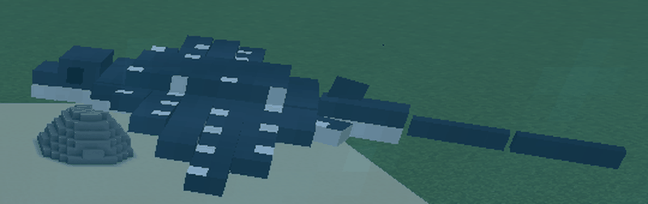

---
navigation:
  title: Spotted eagle ray
  icon: bettacraft:spotted_eagle_ray_spawn_egg
  parent: big_tanks.md
  position: 80
item_ids:
  - bettacraft:spotted_eagle_ray_spawn_egg
---

# Spotted eagle ray

A ray of the open water: a dark blue-black disc covered with small white spots, wings with pointed tips, a head that
sticks out in front with a duck-bill snout and a very long whip tail. In the game it is 1.5 m long; in the wild its wings
span up to 3 m.

**Origin:** warm coastal seas and reefs of the Indo-Pacific (*Aetobatus ocellatus*, long counted as *A. narinari*).

## Profile

| | |
|---|---|
| Group | Rays |
| Scientific name | *Aetobatus ocellatus* |
| Size | about 1.5 m (3 blocks in the game) |
| Tank | at least 18 × 9 blocks, 5 high, 338 water blocks each |
| Temperature | 24–29 °C |
| Water | sea water, sensitive |
| Water chemistry | pH 7.8–8.6 |
| Shoal | alone or as a pair |
| Swims | in the middle |
| Stocking | counts as 84.38 fish |
| Breeding | Does not breed in a tank |
| Special | eats snails, eats shrimp and only the tiniest fish, flies through open water with slow wing beats |

## Keeping

* A big animal for a large **sea water** tank: at least 18 × 9 blocks and 5 blocks of height, 338 water blocks of its own
  ([size rule](../big_tanks.md)).
* It **flies** through the middle of the water with slow, deep beats of its wings and does not lie on the ground. It needs
  open water more than floor space; keep the middle of the tank free.
* It digs for clams and snails with its snout and cracks them; it also eats shrimp. Only the tiniest fish are in danger.
* It does not breed in a tank.

## Obtaining

* **[Large net](large_net.md)** in warm oceans (coral reefs): 0.57 % per swing (about 1 in 175 swings), into an empty transport tub (config `features.bigAnimals`).
* **[Steel leader](steel_leader.md)** (fishing) in warm oceans (coral reefs): 0.71 % per catch (about 1 in 140 catches), into an empty transport tub (config `features.bigAnimals`).
* **Wild** in warm oceans (coral reefs), alone (spawn weight 1) (config `features.bigAnimals`).

The biomes of biome mods count too ([biome tags](../settings.md)).
