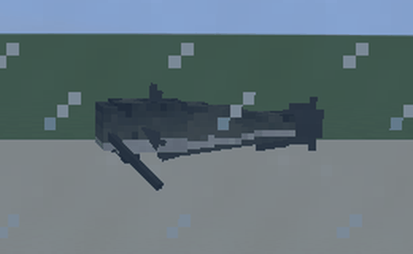

---
navigation:
  title: Wels catfish
  icon: bettacraft:wels_catfish_spawn_egg
  parent: big_tanks.md
  position: 30
item_ids:
  - bettacraft:wels_catfish_spawn_egg
---

# Wels catfish

The giant catfish of Europe: a long, scaleless, marbled olive-brown body with a broad, flat head, two very long barbels on
the upper jaw and four short ones on the chin, a tiny dorsal fin and an endless anal fin that runs to the small tail. In
the game it is 1.5 metres long; in the wild it can reach 2.7 m.

**Origin:** the deep, slow rivers and lakes of central and eastern Europe.

## Profile

| | |
|---|---|
| Group | Catfish |
| Scientific name | *Silurus glanis* |
| Size | about 1.5 m (3 blocks in the game) |
| Tank | at least 18 × 9 blocks, 5 high, 338 water blocks each |
| Temperature | 4–26 °C |
| Water | fresh water, hardy |
| Water chemistry | pH 6.5–8.5, TDS 50–800 ppm |
| Shoal | alone or as a pair |
| Swims | in the lower water |
| Stocking | counts as 84.38 fish |
| Breeding | Does not breed in a tank |
| Betta tank | no (eats them) |
| Special | eats small fish, bettas and shrimp, swims wide curves, active at night |

## Keeping

* A big animal: it needs a tank of at least 18 × 9 blocks and 5 blocks of height, and 338 water blocks of its own
  ([size rule](../big_tanks.md)).
* A fish of cool water: 4–26 °C, so it needs no heater. Hardy, neutral to hard water.
* A night hunter: by day it mostly lies on the ground, at night it cruises the tank.
* It eats small fish, bettas and shrimp. It spawns in a nest in shallow, warm water in spring, never in a tank.
* Very rare in the wild: only now and then in deep rivers.

## Obtaining

* **[Large net](large_net.md)** in rivers: 1 % per swing (about 1 in 100 swings), into an empty transport tub (config `features.bigAnimals`).
* **[Steel leader](steel_leader.md)** (fishing) in rivers: 1.3 % per catch (about 1 in 80 catches), into an empty transport tub (config `features.bigAnimals`).
* **Wild** in rivers, in groups of 1–1 (spawn weight 1) (config `features.bigAnimals`).

The biomes of biome mods count too ([biome tags](../settings.md)).
