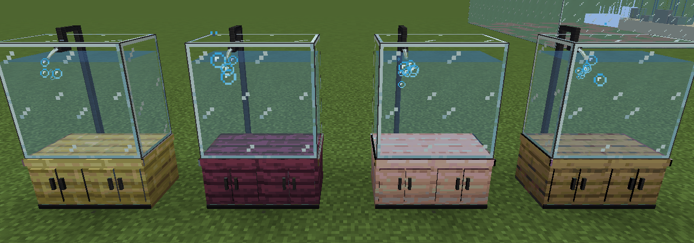
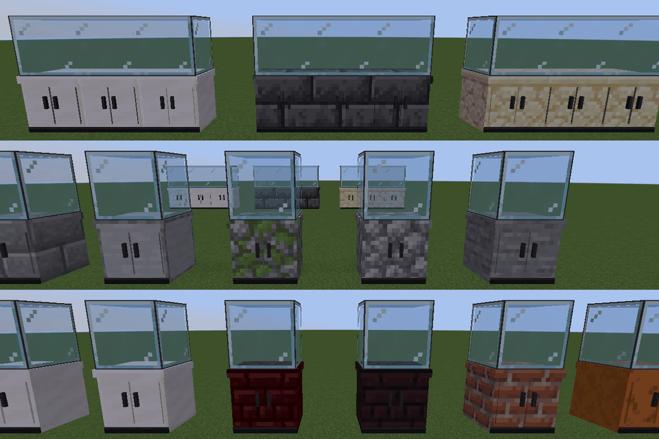

---
navigation:
  title: Cabinet
  icon: bettacraft:cabinet
  parent: equipment.md
  position: 50
item_ids:
  - bettacraft:cabinet
---

# Aquarium cabinet

The <ItemLink id="bettacraft:cabinet" /> is a stand for the aquarium, made of **any wood**: five planks of one kind
(also from other mods), three wooden slabs and a wooden chest. The cabinet takes the look of its planks.

<RecipeFor id="bettacraft:cabinet" />

* Cabinets next to each other that face the same way join into one long cabinet with a continuous top.
* **Filter slot:** put an [external filter](filters.md) in. A cabinet directly under the aquarium then counts as an
  attached external filter; the hose runs up the back wall. The two heater slots of the cabinet menu are the heater
  slots of that filter.
* **Nine storage slots** for food and other things. Hoppers can use them, and the [feeder](feeder.md) on the aquarium
  takes food from the cabinets under it.
* Broken, the cabinet drops its contents like a chest and keeps its wood.

## Stone cabinets

A cabinet can also be made of **stone**: five blocks of one stone, three **slabs of the same stone** and a wooden chest
(stone bricks with stone brick slabs, sandstone with sandstone slabs ...). Every stone with its own slabs works: stone,
cobblestone, granite, diorite, andesite, deepslate, tuff, blackstone, sandstone, bricks, nether bricks, quartz, terracotta
with slabs and the stones of other mods. Metal and copper blocks, glass, purpur, end stone, prismarine, concrete and mud
bricks do not.

<Recipe id="bettacraft:stone_cabinet" />

* The stone cabinet looks like its stone and can do the same as a wooden one (filter, heaters, storage, joined counters).
* It is mined like its stone: with a **pickaxe** (by hand it drops nothing but its contents), as hard and as blast
  resistant as the stone.
* Modpacks can add stones with the item tag `#bettacraft:cabinet_stones` and rule some out with
  `#bettacraft:cabinet_excluded`. The setting `features.stoneCabinets` switches the stone recipe off.
