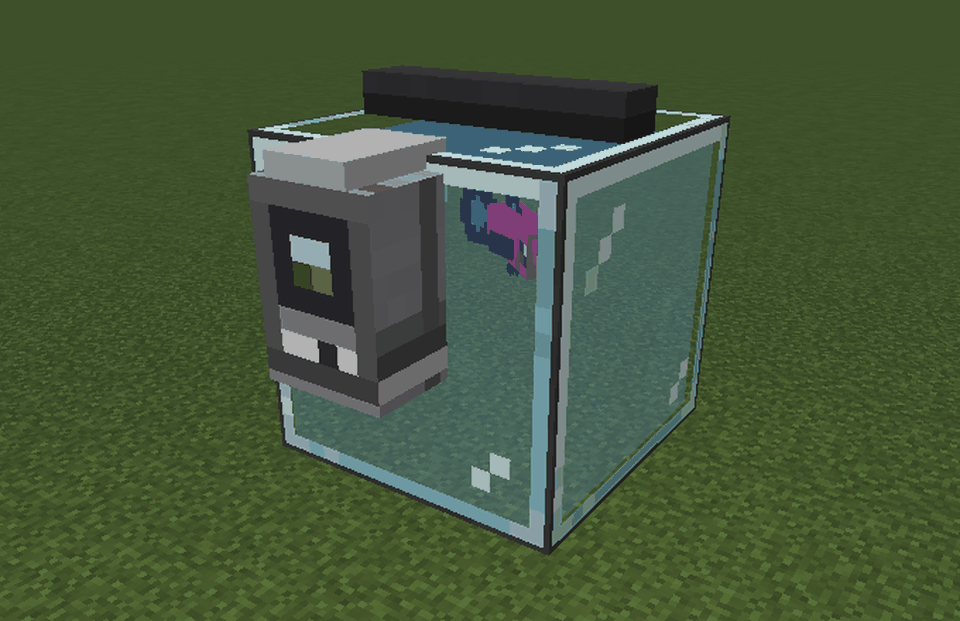

---
navigation:
  title: Clip-on Feeder
  icon: bettacraft:clip_feeder
  parent: equipment.md
  position: 31
item_ids:
  - bettacraft:clip_feeder
---

# Clip-on Feeder

The feeder and the light both need the block above the aquarium. On a tank that is only one block high (or whose top is
full of lights) there is no room left: the <ItemLink id="bettacraft:clip_feeder" /> **hangs on the side of the glass**
instead, at the top edge, like the real feeders clipped to an aquarium rim.

<RecipeFor id="bettacraft:clip_feeder" />

* **Place** it on a side face of a **top** tank block (on a lower block it does not hold).
* **Right-click with food**: fills it. It holds **one stack**.
* **Right-click with an empty hand**: 1, 2 or 3 feedings a day (like the big [feeder](feeder.md): morning, afternoon,
  evening). **Sneak + right-click** with an empty hand takes the food out.
* No hopper, no menu, and it does **not** cover the water against evaporation.
* If there is a big feeder on the aquarium too, that one feeds; the clip-on feeder is for the tanks without one.
* It falls off when the glass behind it is broken. Config switch: `features.clipOnFeeder`.
