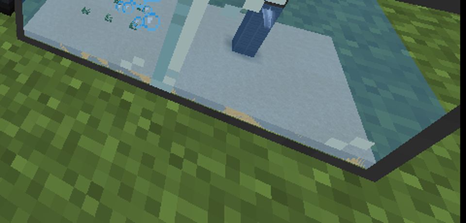

---
navigation:
  title: Filters
  icon: bettacraft:internal_filter
  parent: equipment.md
  position: 20
item_ids:
  - bettacraft:internal_filter
  - bettacraft:external_filter
---

# Filters

Filters bring movement into the aquarium: a water jet, bubbles and a quiet bubbling sound (can be turned off in the
client config, `sound.filterSound`). The flow has **no effect** on the fish.

## Internal filter

<ItemImage id="bettacraft:internal_filter" scale="2" />

Place the <ItemLink id="bettacraft:internal_filter" /> in the [interior](../interior.md): it becomes a filter tower
(2x2x8 blocks at scale 16) whose outlet faces you. The aquarium shows a water jet at its outlet.

<RecipeFor id="bettacraft:internal_filter" />

## External filter

The <ItemLink id="bettacraft:external_filter" /> stands **next to the aquarium** and points at it: placed against a
tank block it turns towards it, at any height of any side wall. A hose runs over the glass rim and a jet pours into the
water (under water it is a short current).

* It has **two heater slots** for [heaters](heaters.md) of any size. Open it with a right-click or right-click it with
  a heater. While the filter is attached, its heaters heat the aquarium.
* Broken, it keeps its heaters in the item (the tooltip lists them).
* It can also go into an [aquarium cabinet](cabinet.md) under the aquarium.

<RecipeFor id="bettacraft:external_filter" />

The tank menu shows "Filters: 1 outside (heaters: 2), 1 inside".
