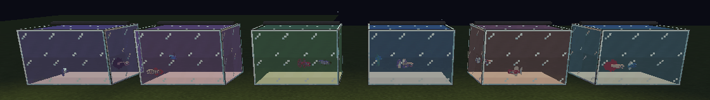
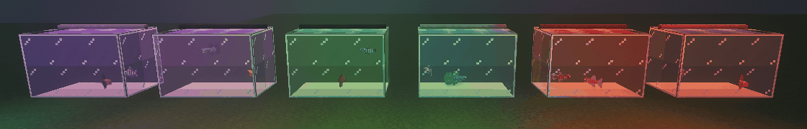
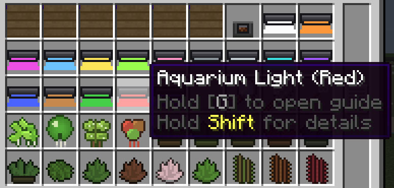

---
navigation:
  title: Light
  icon: bettacraft:tank_light
  parent: equipment.md
  position: 60
item_ids:
  - bettacraft:tank_light
---

# Aquarium light

<GameScene zoom="4" interactive={true}>
  <Block id="bettacraft:tank_light" x="0" p:axis="x" p:pos="true" />
  <Block id="bettacraft:tank_light" x="1" p:axis="x" p:neg="true" p:pos="true" />
  <Block id="bettacraft:tank_light" x="2" p:axis="x" p:neg="true" />
</GameScene>

The <ItemLink id="bettacraft:tank_light" /> gives light level 15.

* Lights next to each other in a row join into **one long bar** (only lengthwise, not into a surface).
* Place it on top of the aquarium, on the glass rim or **hanging** under a block above the aquarium.
* It is on by default. A **redstone signal** at any part of the bar switches the whole bar off, for example with a
  daylight sensor.
* The tank menu shows how many lights are on ("Light: 4/4 on").

## Colours

The light comes in the **16 dye colours**. White is the light it always was (lights of older worlds stay white).

* **Right-click a light with a dye**: the whole bar takes the colour, for a single dye.
* Or craft it: a light (any colour) with a dye, or eight lights around a dye. A white dye makes it white again.
* The colour **tints the water** of the aquarium under it (several colours on one aquarium mix, white ones make it
  paler) and the panel of the lamp glows in it. Black gives a violet "black light".
* The colour is **only for looks**: the light level stays 15, and plants, the red root floater and algae get exactly the
  same light as under a white lamp.
* How strongly the water is tinted is a client option (`render.lightTint`, 0 to 1, default 0.6).
* With a **shader pack** (Iris) the water keeps its tint. Packs with coloured block light (Complementary: the "Colored
  Lighting" option) also give the light of the lamp its colour; the lamp uses the light colour of the lit candle of
  the same colour.

## Obtaining

Crafting:

<RecipesFor id="bettacraft:tank_light" />
