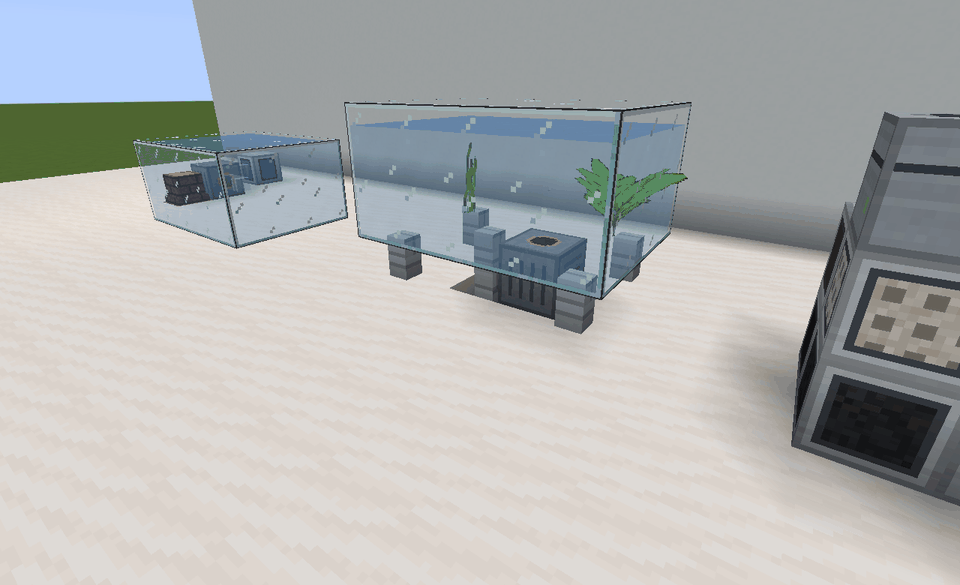

---
navigation:
  title: Multiblock external filter
  icon: bettacraft:filter_pump_head
  parent: equipment.md
  position: 38
item_ids:
  - bettacraft:filter_chamber
  - bettacraft:filter_pump_head
  - bettacraft:filter_inlet
  - bettacraft:filter_outlet
  - bettacraft:filter_inlet_pipe
  - bettacraft:filter_outlet_pipe
  - bettacraft:pipe_tee
  - bettacraft:intake_guard
  - bettacraft:outlet_guard
  - bettacraft:filter_fresh_pipe
  - bettacraft:filter_waste_pipe
  - bettacraft:filter_fresh_port
  - bettacraft:filter_waste_port
---

# Multiblock external filter

<GameScene zoom="3" interactive={true}>
  <Block id="bettacraft:filter_chamber" p:medium="sponge" />
  <Block id="bettacraft:filter_chamber" y="1" p:medium="ceramic" />
  <Block id="bettacraft:filter_pump_head" y="2" p:active="true" />
  <Block id="bettacraft:filter_inlet" x="-1" p:facing="west" />
  <Block id="bettacraft:filter_outlet" x="-1" y="1" p:facing="west" />
</GameScene>

A big external filter you build yourself, in **any size**:

* <ItemLink id="bettacraft:filter_chamber" />: 1 to 16 chambers joined face to face (a column, a 2x2 block ...).
  Each holds one [filter medium](filter_media.md): right-click with it to put it in, with an empty hand to take it out.
* <ItemLink id="bettacraft:filter_pump_head" />: **exactly one**, touching the chambers.
* <ItemLink id="bettacraft:filter_inlet" /> (blue) and <ItemLink id="bettacraft:filter_outlet" /> (orange): at least one
  each, placed against a chamber; their socket faces away and joins a [pipe](pipes.md) or an aquarium block.

The pump head pulls water through the inlet and pushes it out of the outlet (100 mB/t at full power). When **inlet and
outlet lead to the same aquarium** (directly, through pipes or through a [bulkhead](bulkhead.md)), the filter keeps
that aquarium clean: every chamber adds what its medium cleans (sponge 12, ceramic 24, carbon 16, peat 6 water
blocks), less the dirtier the medium is, times the power regulator. Clogged sponges also slow the flow.

Right-click the pump head (or a chamber with an empty hand): the filter's screen with its size, problems, the aquarium
it cleans, the flow and every chamber's medium with its dirt. Sneak + mouse wheel: [power regulator](regulator.md).
With `pipes.pumpsRequireEnergy` the pump head needs FE. A [level sensor](top_off.md) can sit at the filter too.

**Under the aquarium:** the filter may also stand directly under its aquarium, like a cabinet filter: chambers on the
floor, the inlet and the outlet on top of them with their sockets facing up into the aquarium's floor (or chambers
right under the floor and the connectors at the side with pipes up). With a block in your hand a click on a filter part
places the block instead of opening the screen, so you can build the aquarium on top.

The old one-block [external filter](filters.md) stays the small variant.

## Several aquariums, guards

Since M40 one filter serves **several aquariums**. The <ItemLink id="bettacraft:filter_inlet_pipe" /> (blue) leads from
the aquariums to the inlet, the <ItemLink id="bettacraft:filter_outlet_pipe" /> (orange) from the outlet back. A filter
pipe joins at most two neighbours; a <ItemLink id="bettacraft:pipe_tee" /> used on it makes a branch. The pipes dock on
**any side, the top or the bottom** of an aquarium: the pipe dock appears inside at that spot, and interior pipes lead on
from it. The cleaning and the flow are **shared by the water volume** of the aquariums.

Every dock needs a **guard** inside: an <ItemLink id="bettacraft:intake_guard" /> (or an intake strainer) on the inlet
line, an <ItemLink id="bettacraft:outlet_guard" /> (or a lily pipe, nozzle or spray bar) on the return line. Use the guard
on the glass where the pipe docks. **Without a guard the filter does not filter that aquarium** (warning in the aquarium
and filter menus), and a pipe that leads into the aquarium and out again is not allowed. **This also holds for filters
built before the update: fit the guards.**

## Pipe bundles, fresh and waste water

Up to **four lines run in one block**, like the conduits of other mods: right-click a filter pipe with the pipe of another
line and both run on in a pipe bundle (sneak-right-click with an empty hand takes the line you look at out again). Each line
keeps its own connections and T-piece; the lines never mix. The <ItemLink id="bettacraft:filter_fresh_pipe" /> (green) and
the <ItemLink id="bettacraft:filter_waste_pipe" /> (brown) are the two other lines.

The <ItemLink id="bettacraft:filter_fresh_port" /> on a chamber takes water from a water pump, a reservoir, an ME or RS
export bus or the pipes of other mods (straight or through the fresh water line); a water source block next to it is
endless tap water. A **level sensor or water change controller touching the filter** then tops off and changes the water
of **every aquarium of the filter**, shared by what each one needs. The old water goes out of the
<ItemLink id="bettacraft:filter_waste_port" />; without one it is discarded.

## Obtaining

Crafting:

<RecipesFor id="bettacraft:filter_chamber" />
<RecipesFor id="bettacraft:filter_pump_head" />
<RecipesFor id="bettacraft:filter_inlet" />
<RecipesFor id="bettacraft:filter_outlet" />
<RecipesFor id="bettacraft:filter_inlet_pipe" />
<RecipesFor id="bettacraft:filter_outlet_pipe" />
<RecipesFor id="bettacraft:pipe_tee" />
<RecipesFor id="bettacraft:intake_guard" />
<RecipesFor id="bettacraft:outlet_guard" />
<RecipesFor id="bettacraft:filter_fresh_pipe" />
<RecipesFor id="bettacraft:filter_waste_pipe" />
<RecipesFor id="bettacraft:filter_fresh_port" />
<RecipesFor id="bettacraft:filter_waste_port" />
