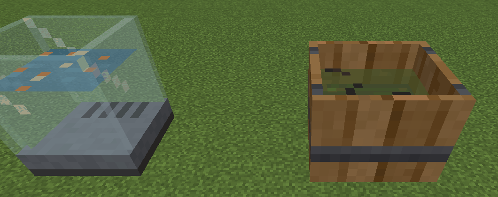

---
navigation:
  title: Breeding live food
  icon: bettacraft:larva_tub
  parent: food.md
  position: 20
item_ids:
  - bettacraft:larva_tub
  - bettacraft:artemia_hatchery
---

# Breeding live food

Instead of hatching every portion from a bottle, you can breed live food in two blocks. Both work with hoppers and
pipes: ingredients go in from the top or the sides, a hopper below takes the food out, a comparator reads how full it is.

## Larva tub

<ItemImage id="bettacraft:larva_tub" scale="2" />

The <ItemLink id="bettacraft:larva_tub" /> breeds [mosquito larvae](../food.md) under the **open sky**.

1. Fill it with a **water bucket** (holds 1000 mB, pipes can fill it as well).
2. Add **organic matter**: leaves, wheat, rotten flesh or bone meal (`#bettacraft:larva_tub_food`). Sneak to put in a
   whole stack.
3. After about **2 in-game days** one batch yields 3 mosquito larvae and uses one organic item and 250 mB of water.
   It is 1.5 times as fast **at night**, 1.3 times in a **swamp** and 1.3 times in the **rain**.
4. Harvest with a **glass bottle** (right-click; the bottle stays empty) or let a hopper below take the larvae.

<RecipeFor id="bettacraft:larva_tub" />

## Artemia hatchery

<ItemImage id="bettacraft:artemia_hatchery" scale="2" />

The <ItemLink id="bettacraft:artemia_hatchery" /> hatches [artemia nauplii](fry_food.md) for fry. It needs **light**
(level 9 or more).

1. Pour in **salt water bottles** (250 mB each, up to 1000 mB). The empty bottles stay in the hatchery.
2. Add **artemia cysts**; each batch uses one of their 16 uses. From a stack the hatchery opens one jar at a time and
   uses it up before it opens the next (breaking the hatchery drops the open jar with its uses).
3. Every bottle of nauplii needs a **glass bottle**: right-click with glass bottles or let a hopper add them.
4. After **1 in-game day** a batch yields 2 bottles of nauplii. Take them with an empty hand or with a hopper below.

<RecipeFor id="bettacraft:artemia_hatchery" />

Right-clicking with an empty hand shows the state (water, ingredient, batch, what is missing); Jade, The One Probe and
WTHIT show the same. The times and amounts can be changed in the server config (`foodBreeding.*`).
