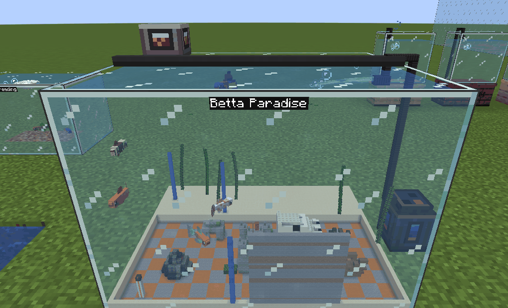

---
navigation:
  title: Bettacraft
  icon: bettacraft:betta_bucket
  position: 0
---

# Bettacraft <Small>by 0verEngineer</Small>

Welcome to the handbook of **Bettacraft**: betta fish (Siamese fighting fish) and aquariums you can build
from any glass, fill with water, decorate from the inside and use to breed bettas with real genetics.

## Where to start

* [First steps](getting_started.md): from the swamp to your first aquarium in seven steps.
* [Bettas](bettas.md): catching, life stages, health, genetics, types, fights.
* [Aquarium](aquarium.md): building tanks, water, inhabitants, temperature and the tank menu.
* [Equipment](equipment.md): heaters, filters, feeder, light and cabinet.
* [Food](food.md): swamp water, mosquito larvae, pellets and food for fry.
* [Breeding](breeding.md): bubble nests, eggs, fry and what the parents need.
* [Small animals](invertebrates.md): shrimp, dwarf crayfish, snails, dwarf clawed frogs and the algae on the glass.
* [Tankmates](tankmates.md): tetras, rasboras, corydoras, plecos, loaches, livebearers and the dwarf gourami, with their own way of breeding.
* [Reef tanks](saltwater.md): salt water, protein skimmer, flow pump, corals on reef rock, clownfish and other reef animals.
* [Interior](interior.md): step into a tank and decorate it block by block.
* [Settings and other mods](settings.md): config options, Jade, JEI and commands.

## Quick reference

| | |
|---|---|
| Comfort temperature | 24 to 30 °C, ideal and for breeding 26 to 28 °C |
| Food | 1 pellet or 1 portion of larvae feeds up to 4 bettas |
| Getting sick | 7 days without food or 7 days at a wrong temperature |
| Stocking | from 2 adults per water block the fish get stressed, at most 6; 25 shrimp or 50 snails count as one fish |
| Growing up | about 9 in-game days from egg to adult |

Hold the open-guide key while hovering over a Bettacraft item to jump to its page.
Every Bettacraft item also explains itself in its tooltip when you hold Shift.
