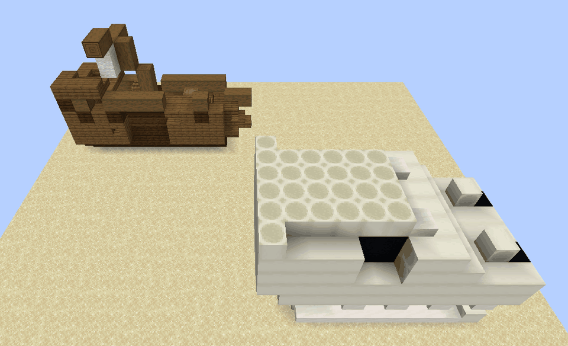
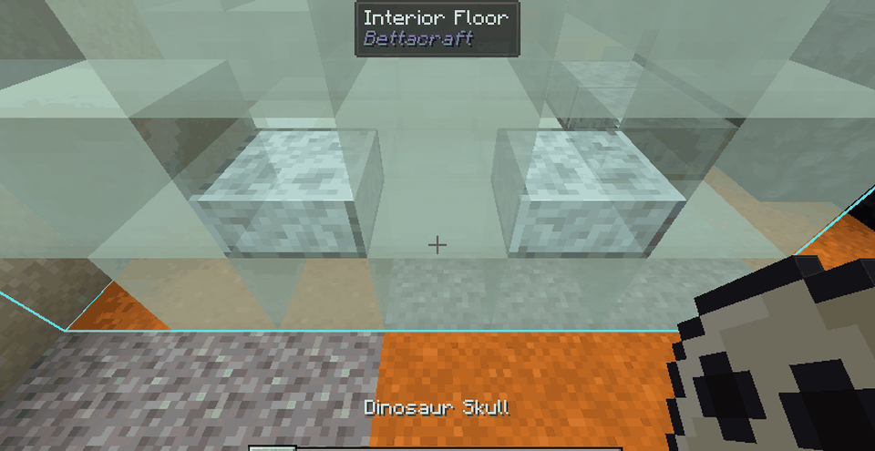

---
navigation:
  title: Decoration
  icon: bettacraft:decor_shipwreck
  parent: interior.md
  position: 20
item_ids:
  - bettacraft:decor_castle
  - bettacraft:decor_shipwreck
  - bettacraft:decor_dino_skull
  - bettacraft:decor_volcano
  - bettacraft:decor_driftwood
  - bettacraft:decor_stones
  - bettacraft:decor_moss_ball
  - bettacraft:decor_hammock
  - bettacraft:decor_almond_leaf
  - bettacraft:decor_cave
---

# Decoration

Decoration items place a **small build** made of vanilla blocks. They work in the [interior](../interior.md), where
they become aquarium decoration, and anywhere else in the world.

* Hold the item and look at the floor: a **hologram** shows where it goes (red: something is in the way).
* Right-click: the build appears facing you and the item is used up.
* The blocks are normal blocks: break, change or extend them as you like.

Sizes are in blocks; at scale 16 that is the same number of pixels in the aquarium.

| Decoration | Size (width x depth, height) |
|---|---|
| <ItemLink id="bettacraft:decor_castle" /> | 8x8, 12 high |
| <ItemLink id="bettacraft:decor_shipwreck" /> | 13x5, 10 high |
| <ItemLink id="bettacraft:decor_dino_skull" /> | 12x6, 8 high |
| <ItemLink id="bettacraft:decor_volcano" /> | 7x7, 6 high |
| <ItemLink id="bettacraft:decor_driftwood" /> | 6x3, 3 high |
| <ItemLink id="bettacraft:decor_stones" /> | 3x3, 2 high |
| <ItemLink id="bettacraft:decor_moss_ball" /> | 1x1, 1 high |
| <ItemLink id="bettacraft:decor_hammock" /> | 3x2, 6 high |
| <ItemLink id="bettacraft:decor_almond_leaf" /> | 3x2, 1 high |
| <ItemLink id="bettacraft:decor_cave" /> | 6x4, 5 high |

Since 1.13.2 the **dinosaur skull** and the **shipwreck** are about twice as big and much more detailed: the skull with
eye sockets, nostrils, a row of teeth and a lower jaw that is a little open; the wreck with a planked hull, a bow with a
bowsprit, a stern castle, a hole in its side and a broken mast with its yard, lying tilted on the bottom. Skulls and
wrecks placed before stay as they are. (`features.detailedDecor` off: new ones are the small old shapes.)

## More decoration (1.21)

* [Wrecks](decor/wrecks.md): a sunken rowing boat and the bow of a sailing ship with a spawning cave in its hold
* [Stones and caves](decor/hardscape.md): holey rock, slate cave, Seiryu stone, dragon stone, lava rock
* [Roots](decor/roots.md): mangrove root, spiderwood, bogwood bridge
* [Caves and tubes](decor/tubes.md): coconut cave, clay tubes, shrimp tubes
* [Ornaments](decor/kitsch.md): ruined column, diving helmet, treasure chest with bubbles
* [Leaf litter](decor/leaf_litter.md): almond leaves and alder cones on the floor

## Recipes

The Indian almond leaf is a classic of betta keeping: in real aquariums its tannins colour the water and calm the
fish. This decoration is only carpet; real leaves laid on the floor
give off tannins: see [leaf litter](decor/leaf_litter.md).

## Obtaining

Crafting:

<RecipesFor id="bettacraft:decor_castle" />
<RecipesFor id="bettacraft:decor_shipwreck" />
<RecipesFor id="bettacraft:decor_dino_skull" />
<RecipesFor id="bettacraft:decor_volcano" />
<RecipesFor id="bettacraft:decor_driftwood" />
<RecipesFor id="bettacraft:decor_stones" />
<RecipesFor id="bettacraft:decor_moss_ball" />
<RecipesFor id="bettacraft:decor_hammock" />
<RecipesFor id="bettacraft:decor_almond_leaf" />
<RecipesFor id="bettacraft:decor_cave" />
