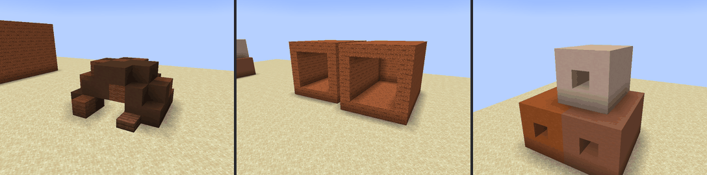

---
navigation:
  title: Caves and tubes
  icon: bettacraft:decor_clay_tubes
  parent: interior/decor.md
  position: 40
item_ids:
  - bettacraft:decor_coconut_cave
  - bettacraft:decor_clay_tubes
  - bettacraft:decor_shrimp_tubes
---

# Caves and tubes

* **Coconut cave:** half a coconut shell lying on its rim, with an entrance at the front: a small cave
  for small fish.
* **Clay tubes:** two tubes of [spawning cave](../../tankmates/breeding.md) blocks side by side, open to the front:
  **two spawning caves** for plecos (each its own cave: they do not touch).
* **Shrimp tubes:** a stack of thin terracotta tubes. With `features.decorEffects`, clay and terracotta in the interior
  (these tubes, spawning caves, dragon stone, lava rock) **hide young shrimp** from hunting bettas: up to 15 % of the
  hunts fail, fully from 40 blocks.

| Decoration | Size (width x depth, height) |
|---|---|
| <ItemLink id="bettacraft:decor_coconut_cave" /> | 6x6, 3 high |
| <ItemLink id="bettacraft:decor_clay_tubes" /> | 13x9, 6 high |
| <ItemLink id="bettacraft:decor_shrimp_tubes" /> | 6x5, 6 high |

## Obtaining

Crafting:

<RecipesFor id="bettacraft:decor_coconut_cave" />
<RecipesFor id="bettacraft:decor_clay_tubes" />
<RecipesFor id="bettacraft:decor_shrimp_tubes" />
