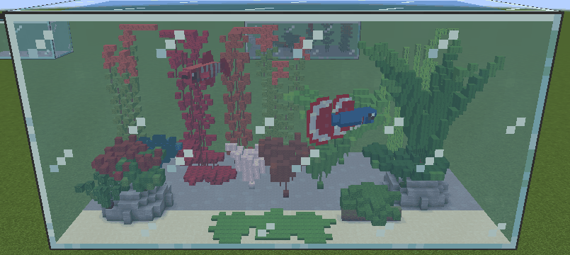
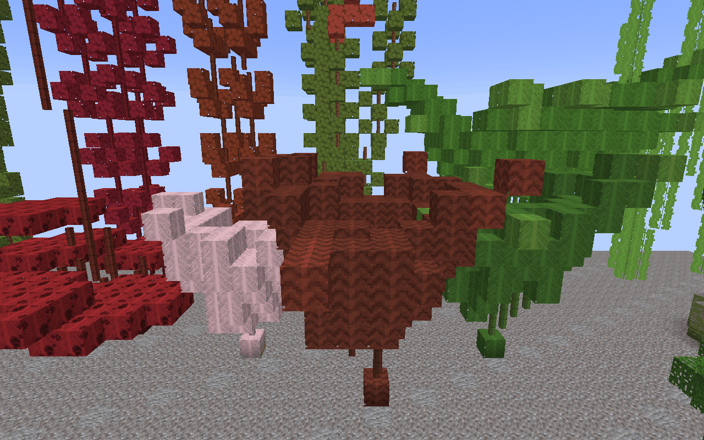
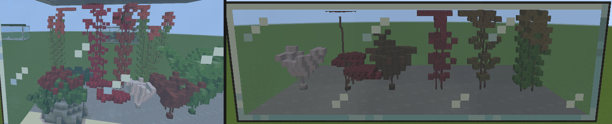
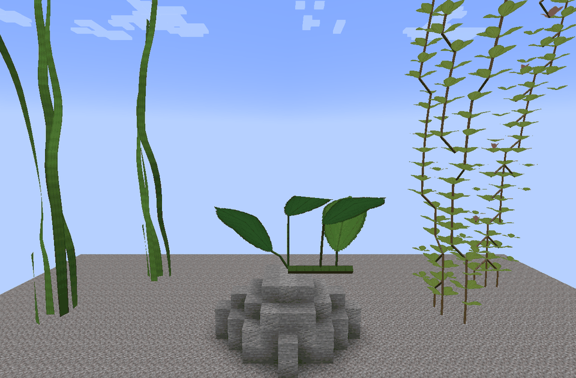
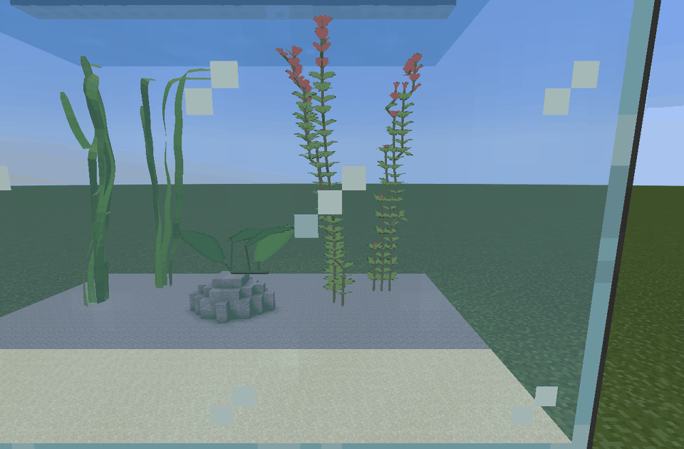

---
navigation:
  title: Aquarium plants
  icon: bettacraft:java_fern
  parent: interior.md
  position: 30
item_ids:
  - bettacraft:java_fern
  - bettacraft:anubias_nana
  - bettacraft:bucephalandra_green_wavy
  - bettacraft:bucephalandra_brownie_red
  - bettacraft:bucephalandra_blue
  - bettacraft:bucephalandra_mini_needle
  - bettacraft:java_moss
  - bettacraft:cryptocoryne_wendtii_green
  - bettacraft:cryptocoryne_wendtii_brown
  - bettacraft:cryptocoryne_flamingo
  - bettacraft:amazon_sword
  - bettacraft:rotala_rotundifolia
  - bettacraft:ludwigia_repens
  - bettacraft:alternanthera_reineckii
  - bettacraft:vallisneria
  - bettacraft:monte_carlo
  - bettacraft:red_tiger_lotus
---

# Aquarium plants

Aquarium plants grow in the [interior](../interior.md) of an aquarium. You plant a **cutting**, smaller than a block,
and over the days it grows into a plant of many blocks: fronds, leaves, stems, ribbons. In the aquarium you see it as
part of the miniature behind the glass. Every plant looks a little different.

## The plants

| | Plant | Grows on | Full size |
|---|---|---|---|
| <ItemImage id="bettacraft:java_fern" /> | <ItemLink id="bettacraft:java_fern" /> | stone, wood | about 12 days |
| <ItemImage id="bettacraft:anubias_nana" /> | <ItemLink id="bettacraft:anubias_nana" /> | stone, wood | about 25 days |
| <ItemImage id="bettacraft:bucephalandra_green_wavy" /> | <ItemLink id="bettacraft:bucephalandra_green_wavy" />, <ItemLink id="bettacraft:bucephalandra_brownie_red" /> (red), <ItemLink id="bettacraft:bucephalandra_blue" /> (bluish), <ItemLink id="bettacraft:bucephalandra_mini_needle" /> | stone, wood | about 20 days |
| <ItemImage id="bettacraft:java_moss" /> | <ItemLink id="bettacraft:java_moss" /> | any solid block | about 6 days |
| <ItemImage id="bettacraft:cryptocoryne_wendtii_green" /> | <ItemLink id="bettacraft:cryptocoryne_wendtii_green" />, <ItemLink id="bettacraft:cryptocoryne_wendtii_brown" /> (brown-red) | substrate | about 9 days |
| <ItemImage id="bettacraft:cryptocoryne_flamingo" /> | <ItemLink id="bettacraft:cryptocoryne_flamingo" /> (whitish pink, rare) | substrate | about 14 days |
| <ItemImage id="bettacraft:amazon_sword" /> | <ItemLink id="bettacraft:amazon_sword" /> | substrate | about 7 days |
| <ItemImage id="bettacraft:rotala_rotundifolia" /> | <ItemLink id="bettacraft:rotala_rotundifolia" /> (red tips), <ItemLink id="bettacraft:ludwigia_repens" /> (red), <ItemLink id="bettacraft:alternanthera_reineckii" /> (deep red) | substrate | 2-4 days, up to the surface |
| <ItemImage id="bettacraft:vallisneria" /> | <ItemLink id="bettacraft:vallisneria" /> | substrate | 2-3 days, up to the surface |
| <ItemImage id="bettacraft:monte_carlo" /> | <ItemLink id="bettacraft:monte_carlo" /> (carpet) | substrate | about 3 days |
| <ItemImage id="bettacraft:red_tiger_lotus" /> | <ItemLink id="bettacraft:red_tiger_lotus" /> | substrate | about 6 days, floating leaves |

**Substrate** is the interior floor with a [substrate](substrate.md) on it, or a block of sand, gravel, dirt, mud or
clay. **Epiphytes** (Java fern, Anubias, Bucephalandra) sit on stone and wood: rocks, logs, planks, also the
[decoration](decor.md). Java moss holds on to any solid block.

## How to get them

There are no crafting recipes. Find plants in the world, then grow your own:

* **Fishing in jungles and rivers** sometimes brings up an epiphyte instead of a fish (5 %): Java fern, Anubias,
  Bucephalandra; the "Blue" and "Brownie Red" are rare.
* **Swamps:** fishing in swamps and mangrove swamps brings up Cryptocoryne, Ludwigia or Rotala, and a bottle of swamp
  water sometimes holds a cutting as well (5 %).
* **Lush caves:** **shears on a moss block next to water** give Java moss now and then (50 %).
* The **wandering trader** sells Amazon sword, Vallisneria, Monte Carlo and Alternanthera, sometimes the red tiger lotus
  or the Cryptocoryne "Flamingo".
* **Propagation** is the main source: trimming gives cuttings, epiphytes can be divided, stem plants form side shoots
  and Vallisneria, Monte Carlo and the crypts send out runners.

## Growing

* Plants grow with **light** at the surface (a lit [tank light](../equipment/light.md) or daylight), **nutrients**
  (the waste of the animals, see [water quality](../aquarium/water_quality.md)) and a water temperature of 20-30 °C.
  Epiphytes, moss and crypts are content with little light; stem plants and Monte Carlo need strong light.
* They grow **also while nobody is in the interior**: the aquarium keeps track of every plant and writes the blocks of
  a new stage when it is due. You see the miniature grow.
* **Red plants get redder with more light**, like the red root floater: Rotala at the tips, Ludwigia, Alternanthera,
  the brown crypt, the Brownie Red and the tiger lotus. The Flamingo crypt stays whitish pink and gets brighter.

* Stem plants grow up to the surface and run along it. Together with dense
  [floating plants](../aquarium/floating_plants.md) they shade the aquarium: the menu warns, the plants below grow
  slower. Trim them.
* At most 48 plants grow in one aquarium; side shoots and runners keep some distance to each other.

## Trimming, dividing, taking out

* **Shears** on a plant block in the interior cut the plant back by a stage or two; you get **cuttings**.
* **Shears on the aquarium from outside** trim the plant you look at in the miniature (decoration in front of it hides
  it). Everything else you do with the aquarium stays as it was.
* **Breaking the root block** (the lowest block where you planted it) takes the whole plant out; the item keeps its
  size and you can plant it elsewhere.
* **Breaking a rhizome piece** of an epiphyte divides it: half of it comes out as a new plant.
* Dividing and taking out only work inside. When an aquarium block is broken, the plants rooted in it drop as items.

## What they do

* Plants **take up waste** while they have light: the more plant mass, the longer the water stays clean.
* Dense plants are **hiding spots**: after spawning the male chases the female less often (up to 60 % less).
* A well planted aquarium (plants of at least 3 % of the water volume) makes the male ready for a nest a little
  faster (1.1x).
* Bettas swim around the plants like around decoration.

## New look (prototype)

**Rotala**, **Vallisneria** and **Anubias** have a new look: real round, ribbon-shaped and broad leaves instead of leaf
blocks, inside the interior and in the miniature outside the aquarium; Rotala and Vallisneria sway in the water like
kelp, outside just like inside. Every Rotala shoot has its stem (side shoots too), and every Vallisneria leaf is one
ribbon from the ground up to the surface and along it. The blocks are still there (you can cut them with shears and
break them as before), they are only drawn differently. A cut with the shears, growth or a broken block shows on the
plant at once; with a shader pack the leaves cast shadows. From further away than 24 blocks the miniature shows the
plants as pixels again (`render.miniaturePlantMeshDistance` in the client config, 0 = always pixels).
`features.plantMeshes` in the common config switches back to the old look.

All values can be changed in the server config (`interiorPlants.*`): growth speed (0 = no growth), waste uptake,
breeding bonus, hiding spots, most plants per aquarium, side shoots and runners, the chances of fishing, swamp water
and moss.
