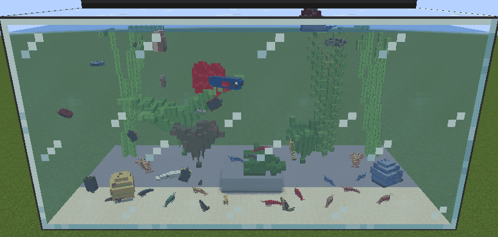

---
navigation:
  title: Small animals
  icon: bettacraft:dwarf_frog_bucket
  parent: index.md
  position: 65
---

# Small animals

Besides the bettas an aquarium can hold a whole community of small animals: **shrimp**, **dwarf crayfish** and
**snails** crawl over the floor, the decoration, the plants and up the glass, and **dwarf clawed frogs** paddle along the
bottom. The snails and shrimp are your **cleaning crew**: they keep the glass free of [algae](invertebrates/algae.md).

* [Shrimp](invertebrates/shrimp.md): Neocaridina in many colours, bred for their grade.
* [Dwarf crayfish](invertebrates/crayfish.md): the orange CPO and its wild form.
* [Snails](invertebrates/snails.md): nerites, apple snails, ramshorns (in colours), bladder, trumpet and assassin snails.
* [Dwarf clawed frogs](invertebrates/frogs.md): breathe at the surface, slow eaters.
* [Algae](invertebrates/algae.md): green film on the glass, the algae scraper.
* [Catching them](invertebrates/catching.md): the aquarium net in rivers, swamps, mangroves and more.
* [Stocking](invertebrates/stocking.md): how many small animals count as one fish.

## In short

* Shrimp, crayfish and snails live in the tank as data, not as single entities: up to 200 per tank (config
  `invertebrates.maxCrittersPerTank`). You see each of them as a small model in the aquarium.
* They come in a [fish bag](bettas.md) (up to 16 of one species per bag). Right-click the tank with the bag to put them
  in; the [aquarium net](aquarium/floating_plants.md) or the button on the **Small animals** page of the animals tab
  takes one out again.
* They eat what grows in the tank on its own (biofilm, more with plants and algae) and what the fish leave over. Too
  many animals for the food: some starve.
* Living small animals keep the aquarium from being broken, like the bettas.
* The [tank menu](aquarium/menu.md) shows every kind with its count, sexes, young and grade, the algae and the food.
