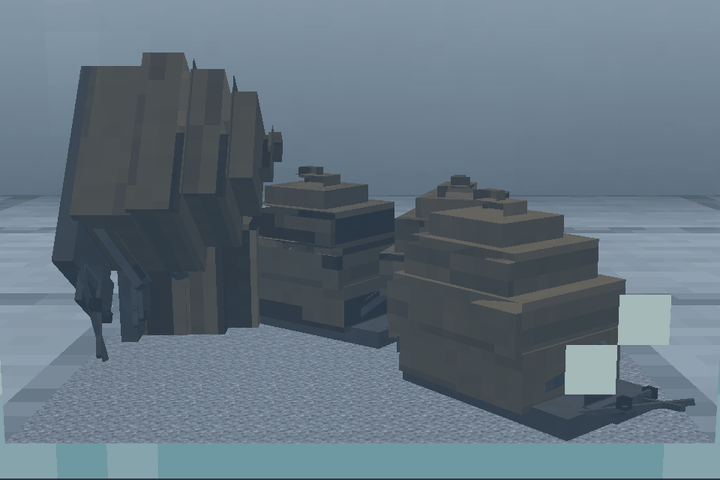

---
navigation:
  title: Apple Snail
  icon: bettacraft:fish_bag
  parent: invertebrates/snails.md
  position: 60
---

# Apple Snail

The spike-topped apple snail (*Pomacea diffusa*) from the Amazon basin: a large snail, nearly always **gold** in the shops, also wild brown, blue, purple and ivory.

## Profile

| | |
|---|---|
| Group | Snails |
| Size in the game | about 5 cm (0.4 blocks) |
| Temperature | 20–30 °C |
| Water | fresh water, normal |
| Water chemistry | pH 6.8–8.6, TDS 100–700 ppm |
| Breeding | male and female; a pink clutch on the glass above the water line, 5–10 young |
| Growing up | about 4 days |
| Algae | grazes 1.5 glass faces a day |
| Climbs the glass | yes |
| Stocking | 50 count as one fish |
| Colour lines | 4 (bred from wild animals) |

## Care

* The female lays a **pink clutch above the water line** on the glass; it needs air above the water.
* After 3 days 5–10 young hatch, unless you take the clutch off with the net or with **Clutches off** in the menu.
* The colours are inherited (recessive); a betta nips at its feelers now and then (only a look).

## Obtaining

* **[Aquarium net](../equipment/tank_net.md)** in jungle water: 16–18 % per swing (about 1 in 6 swings).
* **Wild** in jungle water, in groups of 2–5 (spawn weight 5) (config `features.wildCritters`).
* **Wandering trader** (usual offers): 1 for 3 emeralds.
* **Breeding** in the aquarium (male and female).
