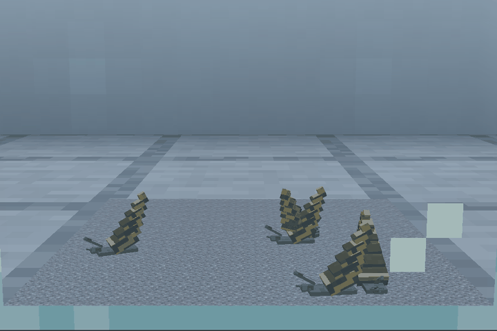

---
navigation:
  title: Assassin Snail
  icon: bettacraft:fish_bag
  parent: invertebrates/snails.md
  position: 100
---

# Assassin Snail

The assassin snail (*Clea helena*) from South-East Asia: a yellow and brown banded shell; it hunts other snails.

## Profile

| | |
|---|---|
| Group | Snails |
| Size in the game | about 2 cm (0.17 blocks) |
| Temperature | 20–30 °C |
| Water | fresh water, normal |
| Breeding | male and female, rarely one young at a time, 1–1 young |
| Growing up | about 6 days |
| Climbs the glass | no |
| Stocking | 50 count as one fish |

## Care

* **Eats other snails** (nerites only rarely, their shell is hard): the natural fix for too many snails.
* Breeds very rarely, in pairs.

## Obtaining

* **[Aquarium net](../equipment/tank_net.md)** in rivers: 0.78 % per swing.
* **[Aquarium net](../equipment/tank_net.md)** in mangrove swamps: 1.4–1.7 % per swing.
* **[Aquarium net](../equipment/tank_net.md)** in deep cave water: 3.5–4.2 % per swing.
* **[Aquarium net](../equipment/tank_net.md)** in lush caves: 2.7–2.9 % per swing.
* **Wandering trader** (rare offers): 1 for 4 emeralds.
* **Breeding** in the aquarium (male and female).
