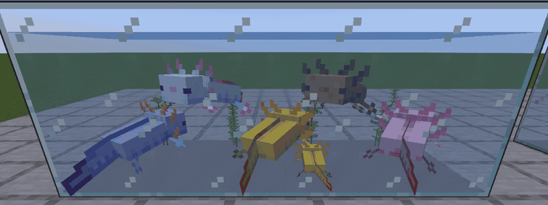

---
navigation:
  title: Axolotl
  icon: minecraft:axolotl_bucket
  parent: invertebrates.md
  position: 45
---

# Axolotl

The **vanilla axolotl** can live in a Bettacraft aquarium (put it in with its bucket). It stays the vanilla animal with
its model and its bucket, so other mods keep working with it, but in a tank it gets **our care and breeding**
(config `features.axolotlCare`).

## Cool water

* Axolotls come from the cold lakes of Mexico: **15 to 20 °C** is right. Most biomes are warmer, so the tank needs a
  [cooler](../equipment/coolers.md) (or a cold biome).
* From **21 °C** they are stressed and do not breed (the tank log says it). Above **23 °C** they lose health, more the
  warmer it gets (`invertebrates.axolotlHeatDamage`, 1 hit point per degree and day). A tropical betta tank (26 °C) is
  no place for them.
* They are predators: they hunt small fish and fry, as in vanilla. Keep them on their own.

## Breeding

* Two adult axolotls in water of 15–20 °C lay **eggs on the plants** of the tank (fine-leaved and broad-leaved plants,
  moss); without plants there are no eggs. One clutch at a time, then the parents rest for a while.
* After about 1.5 days (`invertebrates.axolotlEggDays`) 3 to 6 **larvae** hatch: baby axolotls, which grow up like in
  vanilla. The aquarium net takes the eggs off.
* The breeding speed is `invertebrates.axolotlBreeding`.

## Colours

The five vanilla colours are inherited by Mendel, like the shrimp colours: **leucistic** (pink), **gold**, **cyan** and
**blue** are each a recessive allele at its own locus against the **wild** colour (brown). An axolotl shows a colour only
when it carries it twice; two different colours give wild-coloured young that carry both. With several colours the
rarer one shows: blue over cyan over gold over leucistic.

* **Blue is rare**, as in vanilla: now and then a wild axolotl carries it hidden. Two carriers give about a quarter blue
  young.
* An axolotl that comes into a tank for the first time gets genes from its colour (twice), sometimes with a hidden
  allele. Use the [magnifier](../equipment/magnifier.md) on the tank to read the colour genes of every axolotl (in the chat).
* Taken out with the tank menu, the bucket keeps the genes. A vanilla bucket used in the world does not: the axolotl
  gets new genes from its colour next time.

## Obtaining

* Vanilla: axolotls live in **lush caves**; catch one with a bucket of water.
* **Breeding** in the aquarium (two adults, cool water, plants).
