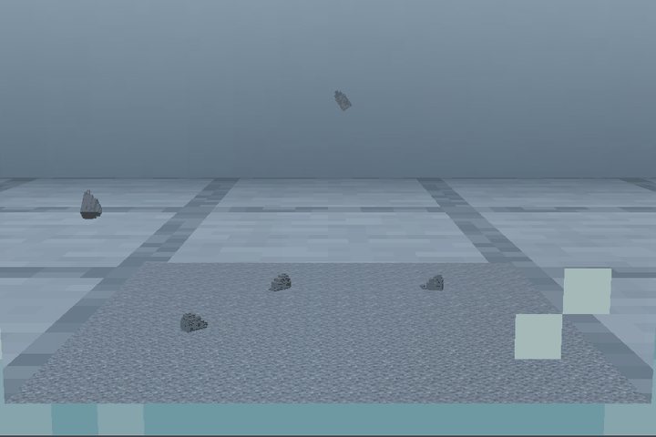

---
navigation:
  title: Bladder Snail
  icon: bettacraft:fish_bag
  parent: invertebrates/snails.md
  position: 80
---

# Bladder Snail

The bladder snail (*Physella acuta*), found in still water all over the world: tiny, with a see-through brown shell.

## Profile

| | |
|---|---|
| Group | Snails |
| Size in the game | about 1 cm (0.07 blocks) |
| Temperature | 10–30 °C |
| Water | fresh water, hardy |
| Breeding | hermaphrodite: one animal is enough, 1–2 young |
| Growing up | about 2 days |
| Algae | grazes 0.3 glass faces a day |
| Climbs the glass | yes |
| Stocking | 50 count as one fish |

## Care

* Hardy and modest; one snail is enough to breed.
* Eats leftovers and a little algae.

## Obtaining

* **[Aquarium net](../equipment/tank_net.md)** in rivers: 6.5–7.7 % per swing, 1–2 at a time.
* **[Aquarium net](../equipment/tank_net.md)** in swamps: 8.8–12 % per swing, 1–2 at a time.
* **Breeding** in the aquarium (one animal is enough).
