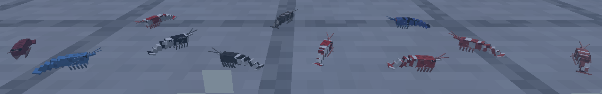

---
navigation:
  title: Bee shrimp (Caridina)
  icon: bettacraft:fish_bag
  parent: invertebrates.md
  position: 12
---

# Bee shrimp (Caridina)

The bee shrimp (*Caridina* cf. *cantonensis* and the Tiger shrimp) from the soft forest streams of southern China are
the jewels of shrimp keeping: white with red or black bands, or bright blue. They are as small as the
[Neocaridina](neocaridina.md) but much pickier: they **need soft, slightly acidic water** and do not live in tap
water. They are a species of their own and **do not cross with the Neocaridina**.

## Profile

| | |
|---|---|
| Group | Shrimp |
| Size in the game | about 2.5 cm (0.2 blocks) |
| Temperature | 18–26 °C |
| Water | fresh water, sensitive |
| Water chemistry | pH 5.5–6.8, TDS 100–200 ppm |
| Breeding | male and female; the female carries the eggs, the young hatch fully formed, 2–6 young |
| Growing up | about 4 days |
| Algae | grazes 0.06 glass faces a day |
| Climbs the glass | yes |
| Stocking | 25 count as one fish |
| Colour lines | 4 (bred from wild animals) |

## Colour lines and banding grades

| Colour line | Varieties |
|---|---|
| red (crystal) | **Crystal Red**, **S**, **SS**, **SSS** (by banding grade) |
| black (crystal) | **Crystal Black**, **S**, **SS**, **SSS** (by banding grade) |
| Taiwan bee | **Blue Bolt** (alone or on the black line) |
| Taiwan bee + red | **Wine Red** |
| Tiger | **Orange Eye Blue Tiger** (deep blue with thin dark stripes and orange eyes) |
| none | Wild form (brownish with pale bands) |

* Every line is a **recessive allele at its own locus**, as with the Neocaridina: a shrimp shows a line only when it
  carries it twice. Other mixtures fall back to the wild form.
* The **Taiwan bee factor** turns a crystal line into a solid colour: alone or on black it gives Blue Bolt, on red it
  gives Wine Red.
* The **grade** of a crystal line is its **banding**: the more white, the higher. Under 35 % it is a plain Crystal
  Red or Black (A grade), then **S**, from 60 % **SS** and from 82 % **SSS** (almost all white with a coloured spot on
  the head). The young get the mean of their parents with some scatter and a pull back to average: keep only the best
  for many generations. The [magnifier](../equipment/magnifier.md) shows the hidden alleles.
* In the menu **Into bag** takes the best shrimp out, **Shift + Into bag** the worst.

## The right water

* **pH 5.5 to 6.8 and TDS 100 to 200 ppm.** Normal water (pH 7.5, 250 ppm) is bad for them: they get sick and die.
* Start with [reverse osmosis water](../equipment/reverse_osmosis.md) (TDS 0) and bring it to about 150 ppm with
  [remineralising salt](../aquarium/water_chemistry.md) (sneak: exactly 150). [Active soil](../interior/active_soil.md)
  on the floor holds the pH near 6.3 and the water soft; peat in the filter, driftwood and almond leaves help too (plain
  dirt only half as much).
* Top off with reverse osmosis water, not with normal water: evaporation leaves the minerals behind and the TDS creeps up.
* Cooler than the Neocaridina: 18 to 26 °C. Sensitive to bad water and to too much [CO2](../equipment/co2.md).

## Breeding

* A female (with a male in the tank) carries her eggs for 2.5 days, then 2 to 6 fully formed young hatch; they grow up
  in 4 days. Slower than the Neocaridina, and only in the right water: in water that is only a little off they breed at
  half the rate.
* As with all shrimp, bettas hunt the young; dense plants and Java moss hide them.

## Obtaining

* **[Aquarium net](../equipment/tank_net.md)** in rivers: 1.1–1.3 % per swing (about 1 in 74–88 swings), 1–3 at a time (config `features.caridina`).
* **Wild** in rivers, in groups of 2–5 (spawn weight 1) (config `features.caridina`).
* **Wandering trader** (rare offers): 2 for 8 emeralds (config `features.caridina`).
* **Breeding** in the aquarium (male and female).

The biomes of biome mods count too ([biome tags](../settings.md)).
