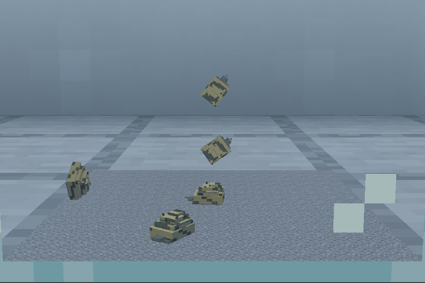

---
navigation:
  title: Horned Nerite
  icon: bettacraft:fish_bag
  parent: invertebrates/snails.md
  position: 20
---

# Horned Nerite

The horned nerite (*Clithon corona*) from the brackish rivers of South-East Asia: a small dark shell with little horns.

## Profile

| | |
|---|---|
| Group | Snails |
| Size in the game | about 1.5 cm (0.13 blocks) |
| Temperature | 20–28 °C |
| Water | fresh, brackish or sea water, normal |
| Breeding | no young in fresh water |
| Algae | grazes 1.6 glass faces a day |
| Climbs the glass | yes |
| Stocking | 50 count as one fish |

## Care

* Small and a good algae eater.
* Never multiplies in fresh water.

## Obtaining

* **[Aquarium net](../equipment/tank_net.md)** in mangrove swamps: 7.2–9 % per swing, 1–2 at a time.
* **[Aquarium net](../equipment/tank_net.md)** at beaches: 7.5–9 % per swing, 1–2 at a time.
