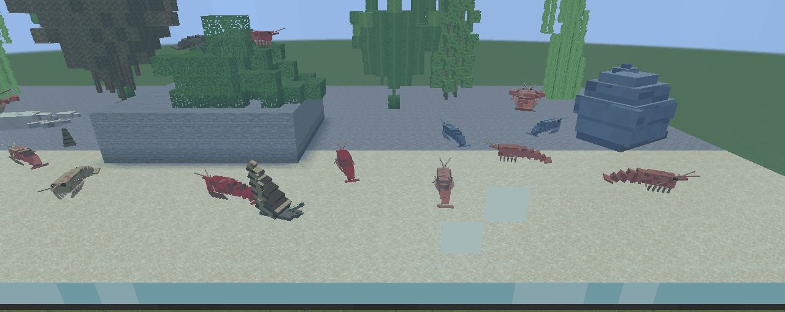

---
navigation:
  title: Neocaridina shrimp
  icon: bettacraft:fish_bag
  parent: invertebrates.md
  position: 10
---

# Neocaridina shrimp

The dwarf shrimp *Neocaridina davidi* (about 2.5 cm) walks over the floor, the stones and the plants, now and then
swims a short jump and grazes the glass a little. Shrimp eat biofilm, algae and the leftovers of the fish food: with
shrimp, overfeeding hardly fouls the water.

## Profile

| | |
|---|---|
| Group | Shrimp |
| Size in the game | about 2.5 cm (0.2 blocks) |
| Temperature | 18–28 °C |
| Water | fresh water, sensitive |
| Breeding | male and female; the female carries the eggs, the young hatch fully formed, 3–8 young |
| Growing up | about 3 days |
| Algae | grazes 0.08 glass faces a day |
| Climbs the glass | yes |
| Stocking | 25 count as one fish |
| Colour lines | 6 (bred from wild animals) |

## Colours

| Colour line | Varieties |
|---|---|
| red | **Red Cherry**, **Sakura**, **Fire Red**, **Painted Fire Red** (by grade) |
| blue | Blue Dream |
| yellow | Yellow |
| orange | Orange |
| green | Green Jade |
| black | Black Rose |
| black + yellow | Chocolate |
| none | Wild form (brownish, see-through) |

## Inheritance

* Every colour is a **recessive allele at its own locus** (Mendel). A shrimp shows a colour only when it carries it
  twice; a wild-coloured shrimp can carry colours hidden.
* **Mixed colours fall back to the wild form**: red x blue gives wild-coloured young that carry red and blue. Cross
  those again and a quarter of the young shows one of the colours.
* On top of the colour there is the **grade** (colour density, 0-100 %). The young get the mean of their parents with a
  little scatter and a slight pull back to average. Keep only the best animals for many generations and the grade
  climbs: a red line goes from Red Cherry (under 30 %) over Sakura and Fire Red to **Painted Fire Red** (from 80 %).
* In the menu, **Into bag** takes the shrimp with the best grade out, **Shift + Into bag** the worst: that is how you
  select a line.

## Breeding

* A female (with a male in the tank) carries her eggs under the tail for 2 days (yellow dots), then 3 to 8 fully formed
  young hatch. No larvae. The young grow up in 3 days.
* Breeding needs food, water that is not bad and 19 to 27 °C. It stops at the limit of the tank.
* **Bettas hunt the young** (and now and then an adult). Dense plants and **Java moss** hide them: in a well planted
  tank most young survive (see the hiding spots in the menu).

## Needs

* 18 to 28 °C. Shrimp are sensitive: below 45 % water quality they die off.
* Food: a tank grows some on its own; plants and algae add to it. A big colony needs leftovers of the fish food.

## Obtaining

* **[Aquarium net](../equipment/tank_net.md)** in rivers: 9.7–11 % per swing (about 1 in 9–10 swings), 1–3 at a time.
* **Wild** in rivers, in groups of 2–5 (spawn weight 2) (config `features.wildCritters`).
* **Wandering trader** (rare offers): 2 for 6 emeralds.
* **Breeding** in the aquarium (male and female).
