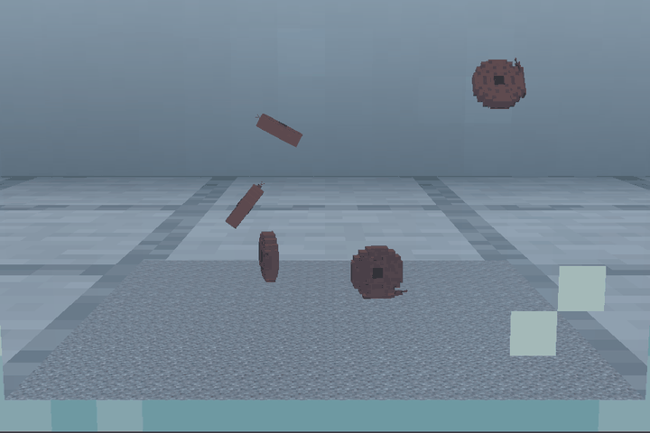

---
navigation:
  title: Ramshorn Snail
  icon: bettacraft:fish_bag
  parent: invertebrates/snails.md
  position: 70
---

# Ramshorn Snail

The ramshorn snail (*Planorbella* sp.) from the still waters of North America: a flat coiled shell, wild red-brown; pink, blue and red come from breeding.

## Profile

| | |
|---|---|
| Group | Snails |
| Size in the game | about 1.5 cm (0.12 blocks) |
| Temperature | 15–30 °C |
| Water | fresh water, normal |
| Breeding | hermaphrodite: one animal is enough, 1–2 young |
| Growing up | about 3 days |
| Algae | grazes 0.6 glass faces a day |
| Climbs the glass | yes |
| Stocking | 50 count as one fish |
| Colour lines | 3 (bred from wild animals) |

## Care

* One snail is enough to breed (hermaphrodite).
* Wild ones sometimes carry pink or blue hidden: two carriers give a quarter coloured young, **pink x pink breeds true**.

## Obtaining

* **[Aquarium net](../equipment/tank_net.md)** in rivers: 7.3–8.6 % per swing (about 1 in 12–14 swings), 1–2 at a time.
* **[Aquarium net](../equipment/tank_net.md)** in swamps: 8.3–11 % per swing (about 1 in 9–12 swings), 1–2 at a time.
* **[Aquarium net](../equipment/tank_net.md)** in lush caves: 6.8–11 % per swing (about 1 in 9–15 swings), 1–2 at a time.
* **Wild** in rivers, in groups of 2–5 (spawn weight 2) (config `features.wildCritters`).
* **Wild** in swamps, in groups of 2–5 (spawn weight 2) (config `features.wildCritters`).
* **Wandering trader** (rare offers): 2 for 4 emeralds.
* **Breeding** in the aquarium (one animal is enough).
