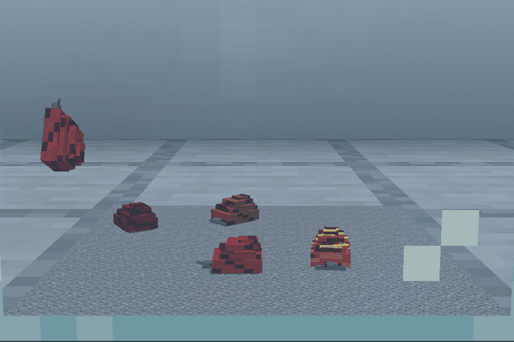

---
navigation:
  title: Red Nerite
  icon: bettacraft:fish_bag
  parent: invertebrates/snails.md
  position: 40
---

# Red Nerite

The red racer nerite (*Vittina waigiensis*, "Red Racer") from Indonesia: orange, red or deep red, some with thin yellow lines.

## Profile

| | |
|---|---|
| Group | Snails |
| Size in the game | about 2 cm (0.16 blocks) |
| Temperature | 20–28 °C |
| Water | fresh, brackish or sea water, normal |
| Water chemistry | pH 6.8–8.6, TDS 100–700 ppm |
| Breeding | no young in fresh water |
| Algae | grazes 2 glass faces a day |
| Climbs the glass | yes |
| Stocking | 50 count as one fish |

## Care

* Every one has its **own shade** (the tooltip of the fish bag names it); it cannot be bred.
* Never multiplies in fresh water.

## Obtaining

* **[Aquarium net](../equipment/tank_net.md)** in mangrove swamps: 1.6–1.9 % per swing (about 1 in 54–63 swings).
* **Wild** in mangrove swamps, in groups of 2–5 (spawn weight 1) (config `features.invertebrates.wildSpawns`).
* **Wandering trader** (rare offers): 2 for 4 emeralds; one of 2 in this offer (config `features.invertebrates.snailColors`).

The biomes of biome mods count too ([biome tags](../settings.md)).
