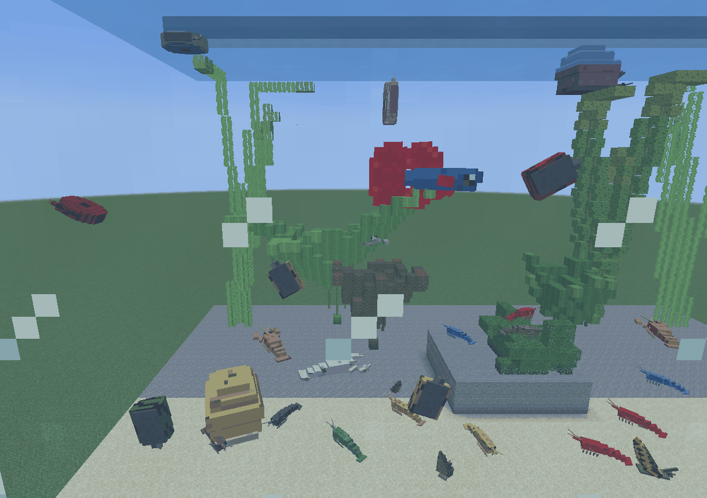
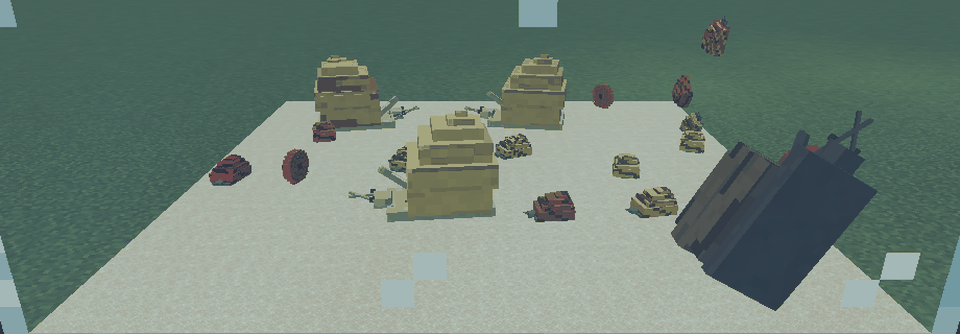

---
navigation:
  title: Snails
  icon: bettacraft:fish_bag
  parent: invertebrates.md
  position: 30
---

# Snails

Snails crawl slowly over everything, also up the decoration and the glass, and graze the algae there. A few snails
keep the glass clean.

| Snail | Breeding | Special |
|---|---|---|
| **Nerites**: zebra, horned, olive, red and yellow racer nerite | no eggs, **never breed** in fresh water | the best algae eaters; the horned nerite has small horns; every racer nerite has its own shade |
| **Apple snail** (*Pomacea diffusa*): **gold** (the usual one), wild brown, blue, purple, ivory | pink clutch **above the water line** on the glass | large; a betta nips at its feelers now and then (only a look) |
| **Ramshorn** (*Planorbella*): red-brown, **pink**, **blue**, **red** | slowly, one snail is enough | colours inherited like the shrimp colours (Mendel + grade) |
| **Bladder snail** | slowly, one is enough | tiny, see-through brown |
| **Malaysian trumpet snail** | slowly, one is enough | digs into the substrate by day, comes out at night |
| **Assassin snail** (*Clea helena*) | very rarely, in pairs | eats other snails (nerites only rarely, their shell is hard): the natural fix for too many snails |

## Racer nerites: every one a little different

The **red racer nerite** (*Vittina waigiensis*, "Red Racer") and its yellow form, the **yellow racer nerite**, never breed
in fresh water, so their colour cannot be bred: every one gets its own when it is caught, bought or made. The red ones are
orange, red or deep red, some red with thin yellow lines; the yellow ones yellow or golden yellow, some with dark lines.
On top of that the brightness and the spacing of the lines vary from snail to snail. The tooltip of the fish bag names the
shade. Snails from worlds before 1.13.2 keep the colour they had.

## Apple snails: mostly gold

Almost every apple snail in the shops is **gold**: at the trader and in the net most are gold now (a stronger yellow
than before), the wild brown ones are rare. Every snail has its own brightness, and gold and wild brown ones sometimes
carry **dark bands** on the shell. The colours are inherited as before (recessive, like the shrimp colours); the shade and
the bands are not.

## Ramshorn colours

Pink, blue and the strong **red** (Red Ramshorn, brighter than the wild red-brown) do not live in the wild. Wild red-brown ramshorns sometimes carry pink or blue hidden: two
carriers give a quarter pink (or blue, or red) young, and **pink x pink breeds true**. A rare trader brings them too.

## Apple snail clutches

A female apple snail (with a male) climbs up the glass **above the water line** and lays a pink clutch there. That needs
air above the water: the air gap under the glass (`tank.waterHeadroom` > 0) or a tank that is not full. After 3 days 5 to
10 young hatch, unless you take the clutch off: aim the [aquarium net](../aquarium/floating_plants.md) at it, or press
**Clutches off** in the menu.

## Notes

* No snail breeds fast; every breeding speed is a config option (`invertebrates.snailBreeding`).
* No snails come along with plants: there are no hitchhikers.
* 50 snails count as one fish for the [stocking](stocking.md).
