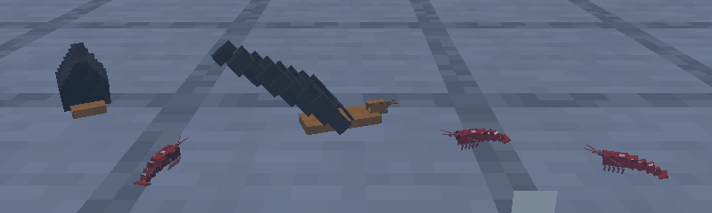

---
navigation:
  title: Cardinal shrimp (Sulawesi)
  icon: bettacraft:fish_bag
  parent: invertebrates.md
  position: 14
---

# Cardinal shrimp (Sulawesi)

The cardinal shrimp (*Caridina dennerli*) lives only in the ancient lakes of **Sulawesi**: deep red with white dots,
small and shy. It is the opposite of the [bee shrimp](caridina.md): it needs **hard, warm, alkaline water**. It shares
its tank best with the [Tylomelania snails](tylomelania.md) of the same lakes.

## Profile

| | |
|---|---|
| Group | Shrimp |
| Size in the game | about 2 cm (0.17 blocks) |
| Temperature | 25–31 °C |
| Water | fresh water, sensitive |
| Water chemistry | pH 7.5–8.6, TDS 150–350 ppm |
| Breeding | male and female; the female carries the eggs, the young hatch fully formed, 1–4 young |
| Growing up | about 5 days |
| Algae | grazes 0.1 glass faces a day |
| Climbs the glass | yes |
| Stocking | 25 count as one fish |

## The right water

* **pH 7.5 to 8.6 and TDS 150 to 350 ppm**, 25 to 31 °C. Tap water just fits (pH 7.5 is the lower end):
  **limestone** on the floor or as rocks (calcite, dripstone, dead coral ...) raises the pH and keeps it there.
* No soil, peat, driftwood or almond leaves: they make the water too acidic. Keep the [CO2](../equipment/co2.md) low.
* Sensitive to bad water: change it often.

## Breeding

* A female carries her few eggs for 3 days, then 1 to 4 young hatch; they need 5 days to grow up. A colony grows
  slowly.
* They graze the glass and the stones a little more than the bee shrimp.

## Obtaining

* **[Aquarium net](../equipment/tank_net.md)** in jungle water: 1–2.2 % per swing (about 1 in 45–96 swings), 1–3 at a time (config `features.sulawesi`).
* **Wild** in jungle water, in groups of 2–5 (spawn weight 1) (config `features.sulawesi`).
* **Wandering trader** (rare offers): 2 for 7 emeralds; one of 2 in this offer (config `features.sulawesi`).
* **Breeding** in the aquarium (male and female).
