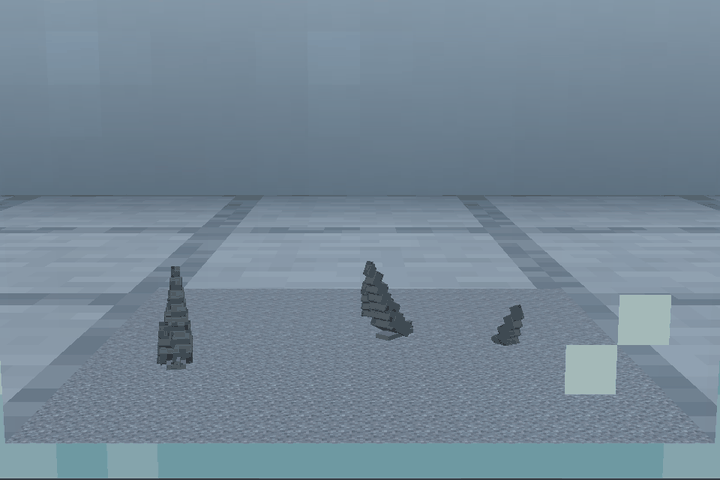

---
navigation:
  title: Malaysian Trumpet Snail
  icon: bettacraft:fish_bag
  parent: invertebrates/snails.md
  position: 90
---

# Malaysian Trumpet Snail

The Malaysian trumpet snail (*Melanoides tuberculata*) from Africa and South Asia: a long, pointed shell.

## Profile

| | |
|---|---|
| Group | Snails |
| Size in the game | about 2 cm (0.17 blocks) |
| Temperature | 18–32 °C |
| Water | fresh water, normal |
| Breeding | hermaphrodite: one animal is enough, 1–2 young |
| Growing up | about 3 days |
| Algae | grazes 0.1 glass faces a day |
| Climbs the glass | no |
| Stocking | 50 count as one fish |

## Care

* **Digs into the substrate by day** and comes out at night; it loosens the ground.
* One snail is enough to breed.

## Obtaining

* **[Aquarium net](../equipment/tank_net.md)** in rivers: 0.97–1.9 % per swing (about 1 in 53–103 swings), 1–2 at a time.
* **[Aquarium net](../equipment/tank_net.md)** in swamps: 6.9–11 % per swing (about 1 in 9–15 swings), 1–2 at a time.
* **[Aquarium net](../equipment/tank_net.md)** in deep cave water: 26–34 % per swing (about 1 in 3–4 swings), 1–2 at a time.
* **[Aquarium net](../equipment/tank_net.md)** in lush caves: 20–27 % per swing (about 1 in 4–5 swings), 1–2 at a time.
* **Shovel** on mud in swamps: 8 % per try, into an empty fish bag.
* **Shovel** on mud in mangrove swamps: 8 % per try, into an empty fish bag.
* **Wild** in rivers, in groups of 2–5 (spawn weight 1) (config `features.wildCritters`).
* **Wild** in swamps, in groups of 2–5 (spawn weight 2) (config `features.wildCritters`).
* **Breeding** in the aquarium (one animal is enough).
