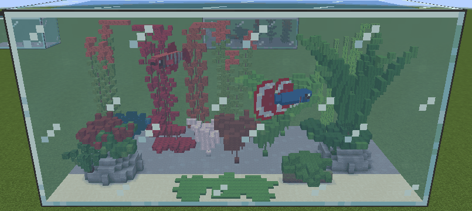

---
navigation:
  title: Plants
  icon: bettacraft:java_fern
  position: 80
---

# Plants

Aquarium plants grow in the [interior](interior.md) of an aquarium. You plant a **cutting**, smaller than a block,
and over the days it grows into a plant of many blocks: fronds, leaves, stems, ribbons. In the aquarium you see it as
part of the miniature behind the glass. Every plant looks a little different.

## All plants

| | Plant | Growth form | Light | Full size |
|---|---|---|---|---|
| <ItemImage id="bettacraft:java_fern" /> | [Java Fern](plants/java_fern.md) | epiphyte (rhizome) | low | about 12 days |
| <ItemImage id="bettacraft:anubias_nana" /> | [Anubias Nana](plants/anubias_nana.md) | epiphyte (rhizome) | low | about 25 days |
| <ItemImage id="bettacraft:bucephalandra_green_wavy" /> | [Bucephalandra 'Green Wavy'](plants/bucephalandra_green_wavy.md) | epiphyte (rhizome) | low | about 20 days |
| <ItemImage id="bettacraft:bucephalandra_brownie_red" /> | [Bucephalandra 'Brownie Red'](plants/bucephalandra_brownie_red.md) | epiphyte (rhizome) | low | about 22 days |
| <ItemImage id="bettacraft:bucephalandra_blue" /> | [Bucephalandra 'Blue'](plants/bucephalandra_blue.md) | epiphyte (rhizome) | low | about 22 days |
| <ItemImage id="bettacraft:bucephalandra_mini_needle" /> | [Bucephalandra 'Mini Needle'](plants/bucephalandra_mini_needle.md) | epiphyte (rhizome) | low | about 20 days |
| <ItemImage id="bettacraft:java_moss" /> | [Java Moss](plants/java_moss.md) | moss | low | about 6 days |
| <ItemImage id="bettacraft:cryptocoryne_wendtii_green" /> | [Cryptocoryne Wendtii (Green)](plants/cryptocoryne_wendtii_green.md) | rosette | low | about 9 days |
| <ItemImage id="bettacraft:cryptocoryne_wendtii_brown" /> | [Cryptocoryne Wendtii (Brown)](plants/cryptocoryne_wendtii_brown.md) | rosette | medium | about 9 days |
| <ItemImage id="bettacraft:cryptocoryne_flamingo" /> | [Cryptocoryne 'Flamingo'](plants/cryptocoryne_flamingo.md) | rosette | medium | about 14 days |
| <ItemImage id="bettacraft:amazon_sword" /> | [Amazon Sword](plants/amazon_sword.md) | rosette | medium | about 7 days |
| <ItemImage id="bettacraft:rotala_rotundifolia" /> | [Rotala Rotundifolia](plants/rotala_rotundifolia.md) | stem plant | strong | about 2.5 days |
| <ItemImage id="bettacraft:ludwigia_repens" /> | [Ludwigia Repens](plants/ludwigia_repens.md) | stem plant | medium | about 3 days |
| <ItemImage id="bettacraft:alternanthera_reineckii" /> | [Alternanthera Reineckii](plants/alternanthera_reineckii.md) | stem plant | very strong | about 3.5 days |
| <ItemImage id="bettacraft:vallisneria" /> | [Vallisneria](plants/vallisneria.md) | ribbons with runners | medium | about 2.5 days |
| <ItemImage id="bettacraft:monte_carlo" /> | [Monte Carlo](plants/monte_carlo.md) | carpet | very strong | about 3 days |
| <ItemImage id="bettacraft:red_tiger_lotus" /> | [Red Tiger Lotus](plants/red_tiger_lotus.md) | bulb with floating leaves | medium | about 6 days |
| <ItemImage id="bettacraft:anubias_nana_petite" /> | [Anubias Nana 'Petite'](plants/anubias_nana_petite.md) | epiphyte (rhizome) | low | about 30 days |
| <ItemImage id="bettacraft:anubias_pinto" /> | [Anubias 'Pinto'](plants/anubias_pinto.md) | epiphyte (rhizome) | low | about 32 days |
| <ItemImage id="bettacraft:anubias_white" /> | [Anubias 'White'](plants/anubias_white.md) | epiphyte (rhizome) | medium | about 30 days |
| <ItemImage id="bettacraft:anubias_coffeefolia" /> | [Anubias Coffeefolia](plants/anubias_coffeefolia.md) | epiphyte (rhizome) | low | about 25 days |
| <ItemImage id="bettacraft:anubias_barteri_round_leaf" /> | [Anubias Barteri 'Round Leaf'](plants/anubias_barteri_round_leaf.md) | epiphyte (rhizome) | low | about 28 days |
| <ItemImage id="bettacraft:bucephalandra_kedagang" /> | [Bucephalandra 'Kedagang'](plants/bucephalandra_kedagang.md) | epiphyte (rhizome) | low | about 22 days |
| <ItemImage id="bettacraft:bucephalandra_theia" /> | [Bucephalandra 'Theia'](plants/bucephalandra_theia.md) | epiphyte (rhizome) | low | about 20 days |
| <ItemImage id="bettacraft:bucephalandra_godzilla" /> | [Bucephalandra 'Godzilla'](plants/bucephalandra_godzilla.md) | epiphyte (rhizome) | low | about 24 days |
| <ItemImage id="bettacraft:bucephalandra_pink_lady" /> | [Bucephalandra 'Pink Lady'](plants/bucephalandra_pink_lady.md) | epiphyte (rhizome) | medium | about 24 days |
| <ItemImage id="bettacraft:bucephalandra_mini_pink" /> | [Bucephalandra 'Mini Pink'](plants/bucephalandra_mini_pink.md) | epiphyte (rhizome) | medium | about 22 days |
| <ItemImage id="bettacraft:bucephalandra_snow_white" /> | [Bucephalandra 'Snow White'](plants/bucephalandra_snow_white.md) | epiphyte (rhizome) | medium | about 26 days |
| <ItemImage id="bettacraft:ludwigia_super_red" /> | [Ludwigia 'Super Red'](plants/ludwigia_super_red.md) | stem plant | strong | about 3.5 days |
| <ItemImage id="bettacraft:rotala_hra" /> | [Rotala 'H'ra'](plants/rotala_hra.md) | stem plant | strong | about 3 days |
| <ItemImage id="bettacraft:rotala_wallichii" /> | [Rotala Wallichii](plants/rotala_wallichii.md) | stem plant | very strong | about 3.5 days |
| <ItemImage id="bettacraft:hygrophila_pinnatifida" /> | [Hygrophila Pinnatifida](plants/hygrophila_pinnatifida.md) | stem plant | medium | about 5 days |
| <ItemImage id="bettacraft:pogostemon_helferi" /> | [Pogostemon Helferi 'Downoi'](plants/pogostemon_helferi.md) | stem plant | strong | about 6 days |
| <ItemImage id="bettacraft:limnophila_sessiliflora" /> | [Limnophila Sessiliflora](plants/limnophila_sessiliflora.md) | stem plant | medium | about 2.5 days |
| <ItemImage id="bettacraft:myriophyllum_red" /> | [Myriophyllum 'Red'](plants/myriophyllum_red.md) | stem plant | strong | about 3 days |
| <ItemImage id="bettacraft:bacopa_caroliniana" /> | [Bacopa Caroliniana](plants/bacopa_caroliniana.md) | stem plant | medium | about 4 days |

## In this chapter

<SubPages icons={true} />
