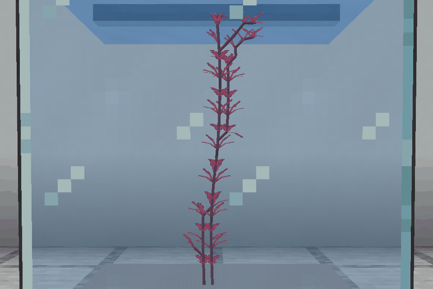

---
navigation:
  title: Alternanthera Reineckii
  icon: bettacraft:alternanthera_reineckii
  parent: plants/stem_plants.md
  position: 30
item_ids:
  - bettacraft:alternanthera_reineckii
---

# Alternanthera Reineckii

*Alternanthera reineckii* from South America: a stem plant with deep red leaves.

## Profile

| | |
|---|---|
| Growth form | stem plant |
| Grows on | substrate (sand, gravel, dirt, the interior floor) |
| Light | strong |
| Full size | after about 3.5 days |
| Spreads | side shoots |
| Cuttings per trim | 3 |
| Colour | redder in strong light |

## Care

* Needs strong light for its colour.

## Obtaining

* **Wandering trader** (usual offers): 1 for 2 emeralds.
* **Cuttings**: shears on a grown plant give 3 cuttings per trim; it also spreads by itself (side shoots).
