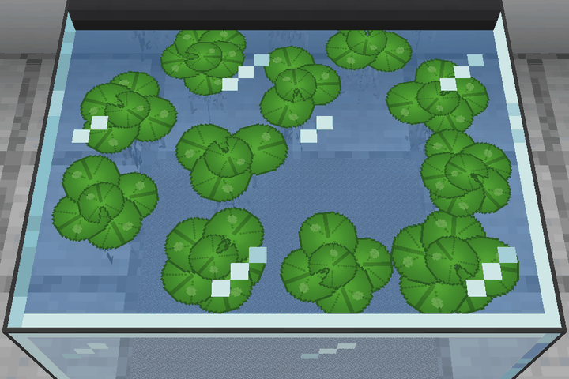

---
navigation:
  title: Amazon Frogbit
  icon: bettacraft:amazon_frogbit
  parent: plants/floating_plants.md
  position: 20
item_ids:
  - bettacraft:amazon_frogbit
---

# Amazon Frogbit

Amazon frogbit (*Limnobium laevigatum*) from Central and South America: round leaves with long roots hanging into the water.

## Profile

| | |
|---|---|
| Growth form | floating plant |
| Leaf size | up to 6.2 cm |
| Growth | medium |
| Waste uptake | ×1.3 |
| Nest site | the favourite |
| Roots | long |

## Care

* The **favourite nest site** of the betta male.
* Its roots are a hiding place for fry.

## Obtaining

* **Fishing** in swamps: 1.2 % per catch (about 1 in 84 catches), instead of the fish.
* **Fishing** in mangrove swamps: 1.3 % per catch (about 1 in 80 catches), instead of the fish.
* **Wandering trader** (usual offers): 2 for 1 emerald.
* **Offshoots**: grows on a lit aquarium surface and forms offshoots; take some out with the aquarium net.

The biomes of biome mods count too ([biome tags](../settings.md)).
