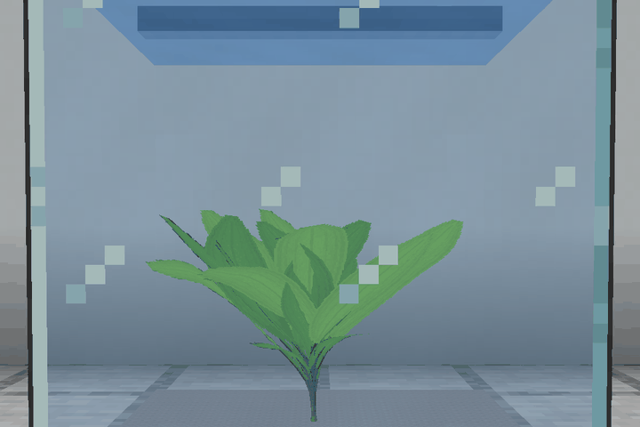

---
navigation:
  title: Amazon Sword
  icon: bettacraft:amazon_sword
  parent: plants/rosettes.md
  position: 40
item_ids:
  - bettacraft:amazon_sword
---

# Amazon Sword

The Amazon sword (*Echinodorus grisebachii* "Bleherae") from South America: a big rosette of long bright-green leaves.

## Profile

| | |
|---|---|
| Growth form | rosette |
| Grows on | substrate (sand, gravel, dirt, the interior floor) |
| Light | medium |
| Full size | after about 7 days |
| Spreads | no |
| Cuttings per trim | 1 |

## Care

* In the substrate; medium light.
* A centrepiece for bigger tanks.

## Obtaining

* **[Aquarium net](../equipment/tank_net.md)** in rivers: 0.48–0.58 % per swing (about 1 in 174–208 swings) (config `features.plantNetCatches`).
* **[Aquarium net](../equipment/tank_net.md)** in jungle water: 2.2–2.7 % per swing (about 1 in 38–45 swings) (config `features.plantNetCatches`).
* **Fishing** in jungle water: 0.37 % per catch (about 1 in 270 catches), instead of the fish.
* **Wandering trader** (usual offers): 1 for 1 emerald.
* **Cuttings**: shears on a grown plant give 1 cutting per trim.

The biomes of biome mods count too ([biome tags](../settings.md)).
