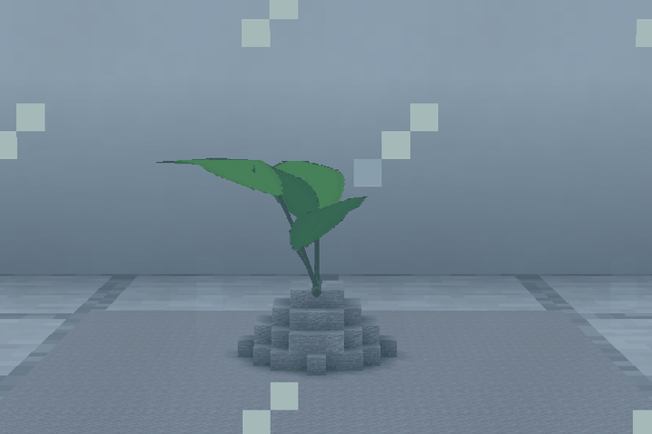

---
navigation:
  title: Anubias Barteri 'Round Leaf'
  icon: bettacraft:anubias_barteri_round_leaf
  parent: plants/epiphytes.md
  position: 25
item_ids:
  - bettacraft:anubias_barteri_round_leaf
---

# Anubias Barteri 'Round Leaf'

*Anubias barteri* "Round Leaf" from West Africa: large, almost round leaves on long stalks.

## Profile

| | |
|---|---|
| Growth form | epiphyte (rhizome) |
| Grows on | stone and wood (also decoration) |
| Light | low |
| Full size | after about 28 days |
| Spreads | no |
| Cuttings per trim | 1 |

## Care

* On stone or wood; very slow, larger than the nana: good on roots in the middle of the tank.
* Little light is enough.

## Obtaining

* **[Aquarium net](../equipment/tank_net.md)** in jungle water: 0.39–0.47 % per swing (about 1 in 212–254 swings) (config `features.plantNetCatches`).
* **Fishing** in jungle water: 0.19 % per catch (about 1 in 540 catches), instead of the fish.
* **Cuttings**: shears on a grown plant give 1 cutting per trim; breaking a rhizome piece divides it.

The biomes of biome mods count too ([biome tags](../settings.md)).
