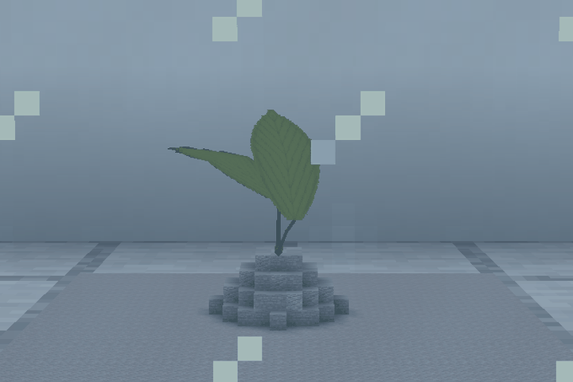

---
navigation:
  title: Anubias Coffeefolia
  icon: bettacraft:anubias_coffeefolia
  parent: plants/epiphytes.md
  position: 24
item_ids:
  - bettacraft:anubias_coffeefolia
---

# Anubias Coffeefolia

*Anubias barteri* var. *coffeefolia* from West Africa: dark green, puckered leaves like those of the coffee plant; the young leaves unfold reddish brown.

## Profile

| | |
|---|---|
| Growth form | epiphyte (rhizome) |
| Grows on | stone and wood (also decoration) |
| Light | low |
| Full size | after about 25 days |
| Spreads | no |
| Cuttings per trim | 1 |

## Care

* On stone or wood; slow and robust.
* Little light is enough.

## Obtaining

* **[Aquarium net](../equipment/tank_net.md)** in jungle water: 0.36–0.43 % per swing (about 1 in 231–277 swings) (config `features.plantNetCatches`).
* **Fishing** in jungle water: 0.17 % per catch (about 1 in 584 catches), instead of the fish.
* **Cuttings**: shears on a grown plant give 1 cutting per trim; breaking a rhizome piece divides it.

The biomes of biome mods count too ([biome tags](../settings.md)).
