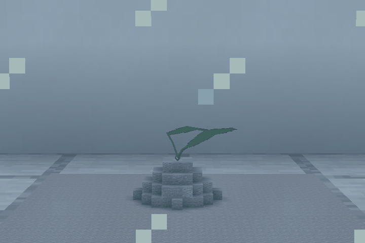

---
navigation:
  title: Anubias Nana 'Petite'
  icon: bettacraft:anubias_nana_petite
  parent: plants/epiphytes.md
  position: 21
item_ids:
  - bettacraft:anubias_nana_petite
---

# Anubias Nana 'Petite'

*Anubias barteri* var. *nana* "Petite" (also "Bonsai"), a dwarf form from the nurseries: the smallest Anubias, tiny dark green leaves close on the rhizome.

## Profile

| | |
|---|---|
| Growth form | epiphyte (rhizome) |
| Grows on | stone and wood (also decoration) |
| Light | low |
| Full size | after about 30 days |
| Spreads | no |
| Cuttings per trim | 1 |

## Care

* On stone or wood; extremely slow, a good plant for the front and for nano tanks.
* Little light is enough.

## Obtaining

* **[Aquarium net](../equipment/tank_net.md)** in jungle water: 0.27–0.32 % per swing (about 1 in 308–369 swings) (config `features.plantNetCatches`).
* **Fishing** in jungle water: 0.21 % per catch (about 1 in 487 catches), instead of the fish.
* **Cuttings**: shears on a grown plant give 1 cutting per trim; breaking a rhizome piece divides it.

The biomes of biome mods count too ([biome tags](../settings.md)).
