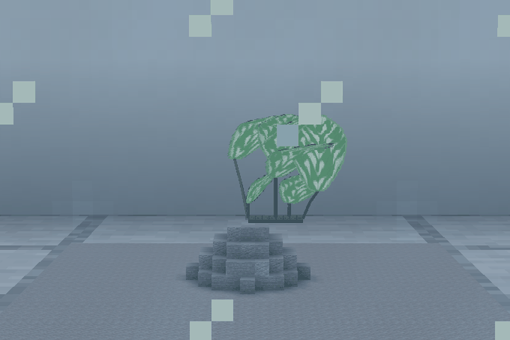

---
navigation:
  title: Anubias 'Pinto'
  icon: bettacraft:anubias_pinto
  parent: plants/epiphytes.md
  position: 22
item_ids:
  - bettacraft:anubias_pinto
---

# Anubias 'Pinto'

*Anubias barteri* "Pinto", a rare cultivated form: dark green leaves marbled with white.

## Profile

| | |
|---|---|
| Growth form | epiphyte (rhizome) |
| Grows on | stone and wood (also decoration) |
| Light | low |
| Full size | after about 32 days |
| Spreads | no |
| Cuttings per trim | 1 |

## Care

* On stone or wood; very slow. Every leaf has its own marbling.
* Little light is enough; rare from fishing in jungle water.

## Obtaining

* **Fishing** in jungle water: 0.07 % per catch (about 1 in 1460 catches), instead of the fish.
* **Shears** on a wild plant in jungle water: 100 % per cut (config `features.wildPlants`).
* **Cuttings**: shears on a grown plant give 1 cutting per trim; breaking a rhizome piece divides it.

The biomes of biome mods count too ([biome tags](../settings.md)).
