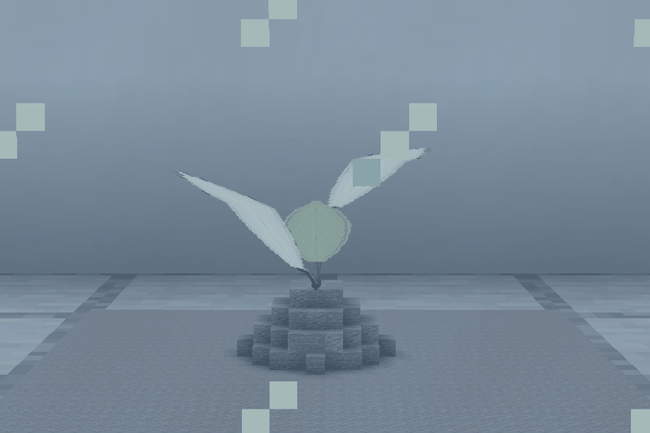

---
navigation:
  title: Anubias 'White'
  icon: bettacraft:anubias_white
  parent: plants/epiphytes.md
  position: 23
item_ids:
  - bettacraft:anubias_white
---

# Anubias 'White'

*Anubias barteri* "White", a cultivated form with almost white leaves; the young leaves are pure white.

## Profile

| | |
|---|---|
| Growth form | epiphyte (rhizome) |
| Grows on | stone and wood (also decoration) |
| Light | medium |
| Full size | after about 30 days |
| Spreads | no |
| Cuttings per trim | 1 |

## Care

* On stone or wood; very slow.
* Needs a little more light than the green Anubias (medium light).

## Obtaining

* **Fishing** in jungle water: 0.07 % per catch (about 1 in 1460 catches), instead of the fish.
* **Cuttings**: shears on a grown plant give 1 cutting per trim; breaking a rhizome piece divides it.

The biomes of biome mods count too ([biome tags](../settings.md)).
