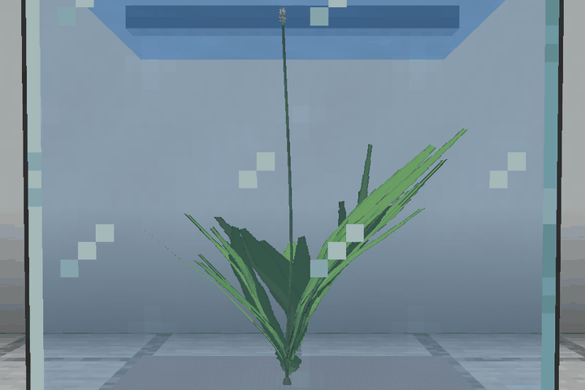

---
navigation:
  title: Aponogeton Ulvaceus
  icon: bettacraft:aponogeton_ulvaceus
  parent: plants/rosettes.md
  position: 70
item_ids:
  - bettacraft:aponogeton_ulvaceus
---

# Aponogeton Ulvaceus

*Aponogeton ulvaceus* from Madagascar: long, light green, undulate leaves from a tuber.

## Profile

| | |
|---|---|
| Growth form | bulb with floating leaves |
| Grows on | substrate (sand, gravel, dirt, the interior floor) |
| Light | medium |
| Full size | after about 6 days |
| Spreads | no |
| Cuttings per trim | 1 |

## Care

* Medium light; the leaves grow long and arch over.
* Grown up it raises a **flower spike** with white flowers to the surface.

## Obtaining

* **[Aquarium net](../equipment/tank_net.md)** in swamps: 0.12–0.14 % per swing (about 1 in 722–867 swings) (config `features.plantNetCatches`).
* **Fishing** in rivers: 0.1 % per catch (about 1 in 1033 catches), instead of the fish.
* **Cuttings**: shears on a grown plant give 1 cutting per trim.

The biomes of biome mods count too ([biome tags](../settings.md)).
