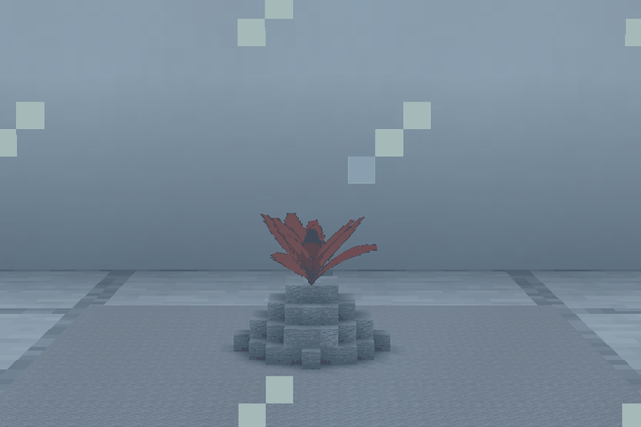

---
navigation:
  title: Bucephalandra 'Brownie Red'
  icon: bettacraft:bucephalandra_brownie_red
  parent: plants/epiphytes.md
  position: 40
item_ids:
  - bettacraft:bucephalandra_brownie_red
---

# Bucephalandra 'Brownie Red'

*Bucephalandra* "Brownie Red" from Borneo: brown-green leaves that turn red in strong light.

## Profile

| | |
|---|---|
| Growth form | epiphyte (rhizome) |
| Grows on | stone and wood (also decoration) |
| Light | low |
| Full size | after about 22 days |
| Spreads | no |
| Cuttings per trim | 1 |
| Colour | redder in strong light |

## Care

* On stone or wood; rare from fishing.
* Redder under a strong light.

## Obtaining

* **Fishing** in jungle water: 0.21 % per catch (about 1 in 487 catches), instead of the fish.
* **Fishing** in rivers: 0.19 % per catch (about 1 in 517 catches), instead of the fish.
* **Shears** on a wild plant in jungle water: 100 % per cut (config `features.wildPlants`).
* **Cuttings**: shears on a grown plant give 1 cutting per trim; breaking a rhizome piece divides it.

The biomes of biome mods count too ([biome tags](../settings.md)).
