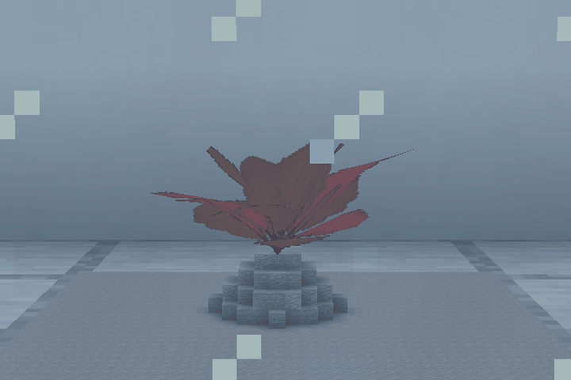

---
navigation:
  title: Bucephalandra 'Godzilla'
  icon: bettacraft:bucephalandra_godzilla
  parent: plants/epiphytes.md
  position: 63
item_ids:
  - bettacraft:bucephalandra_godzilla
---

# Bucephalandra 'Godzilla'

*Bucephalandra* "Godzilla" from Borneo: one of the large ones, broad, wavy leaves in olive brown.

## Profile

| | |
|---|---|
| Growth form | epiphyte (rhizome) |
| Grows on | stone and wood (also decoration) |
| Light | low |
| Full size | after about 24 days |
| Spreads | no |
| Cuttings per trim | 1 |
| Colour | redder in strong light |

## Care

* On stone or wood; slow.
* Redder in strong light.

## Obtaining

* **Fishing** in rivers: 0.1 % per catch (about 1 in 1033 catches), instead of the fish.
* **Cuttings**: shears on a grown plant give 1 cutting per trim; breaking a rhizome piece divides it.

The biomes of biome mods count too ([biome tags](../settings.md)).
