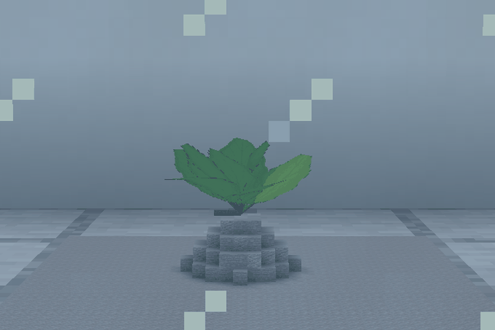

---
navigation:
  title: Bucephalandra 'Green Wavy'
  icon: bettacraft:bucephalandra_green_wavy
  parent: plants/epiphytes.md
  position: 30
item_ids:
  - bettacraft:bucephalandra_green_wavy
---

# Bucephalandra 'Green Wavy'

*Bucephalandra* "Green Wavy" from the streams of Borneo: small wavy green leaves on a rhizome.

## Profile

| | |
|---|---|
| Growth form | epiphyte (rhizome) |
| Grows on | stone and wood (also decoration) |
| Light | low |
| Full size | after about 20 days |
| Spreads | no |
| Cuttings per trim | 1 |

## Care

* On stone or wood; slow, little light.

## Obtaining

* **Fishing** in jungles and rivers: 0.75 % per catch, instead of the fish.
* **Cuttings**: shears on a grown plant give 1 cutting per trim; breaking a rhizome piece divides it.
