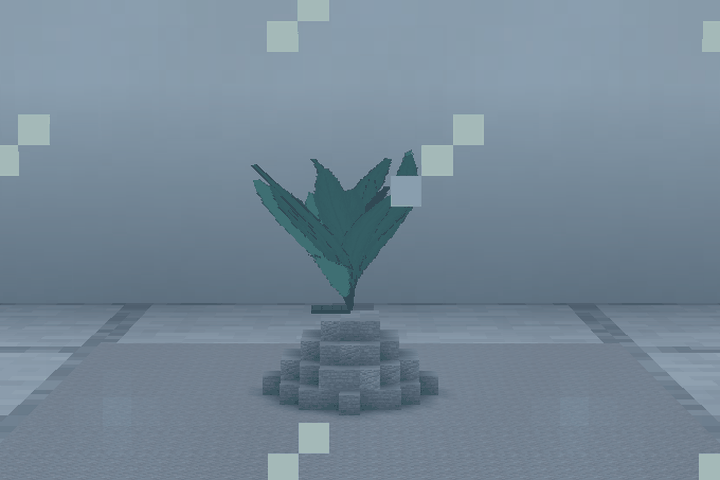

---
navigation:
  title: Bucephalandra 'Kedagang'
  icon: bettacraft:bucephalandra_kedagang
  parent: plants/epiphytes.md
  position: 61
item_ids:
  - bettacraft:bucephalandra_kedagang
---

# Bucephalandra 'Kedagang'

*Bucephalandra* "Kedagang" from the streams of Borneo: narrow, dark green leaves with a bluish shimmer.

## Profile

| | |
|---|---|
| Growth form | epiphyte (rhizome) |
| Grows on | stone and wood (also decoration) |
| Light | low |
| Full size | after about 22 days |
| Spreads | no |
| Cuttings per trim | 1 |

## Care

* On stone or wood; slow.
* Little light is enough.

## Obtaining

* **[Aquarium net](../equipment/tank_net.md)** in rivers: 0.29–0.35 % per swing (about 1 in 289–347 swings) (config `features.plantNetCatches`).
* **Fishing** in rivers: 0.15 % per catch (about 1 in 685 catches), instead of the fish.
* **Cuttings**: shears on a grown plant give 1 cutting per trim; breaking a rhizome piece divides it.

The biomes of biome mods count too ([biome tags](../settings.md)).
