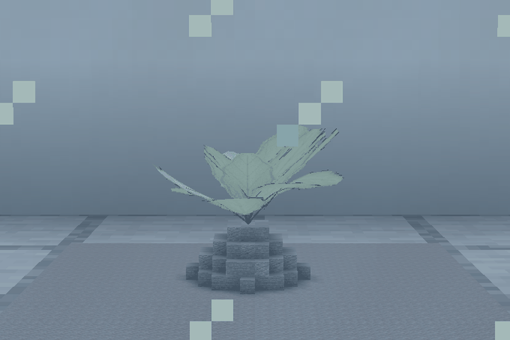

---
navigation:
  title: Bucephalandra 'Snow White'
  icon: bettacraft:bucephalandra_snow_white
  parent: plants/epiphytes.md
  position: 66
item_ids:
  - bettacraft:bucephalandra_snow_white
---

# Bucephalandra 'Snow White'

*Bucephalandra* "Snow White" (also sold as "Biblis") from Borneo: leaves that turn almost white in strong light.

## Profile

| | |
|---|---|
| Growth form | epiphyte (rhizome) |
| Grows on | stone and wood (also decoration) |
| Light | medium |
| Full size | after about 26 days |
| Spreads | no |
| Cuttings per trim | 1 |
| Colour | greenish; white to pink only in strong light (fully under an LED panel or a high-power LED) |

## Care

* On stone or wood; slow; grows with medium light.
* Greenish in ordinary light; white only in strong light, fully only under an [LED panel or a high-power LED](../equipment/light.md) when the light tiers are on.

## Obtaining

* **Fishing** in rivers: 0.04 % per catch (about 1 in 2740 catches), instead of the fish.
* **Cuttings**: shears on a grown plant give 1 cutting per trim; breaking a rhizome piece divides it.

The biomes of biome mods count too ([biome tags](../settings.md)).
