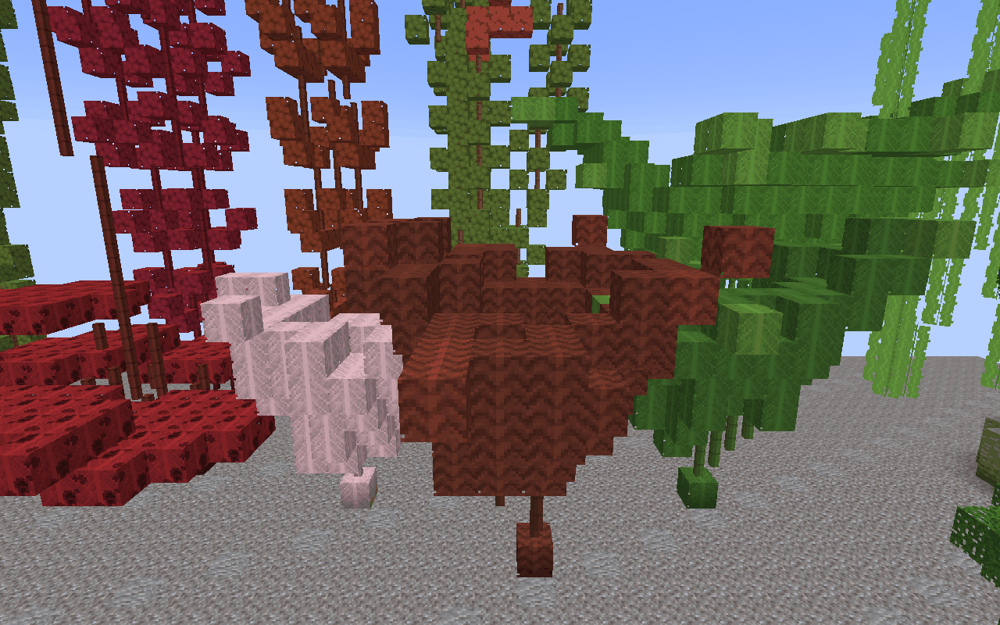
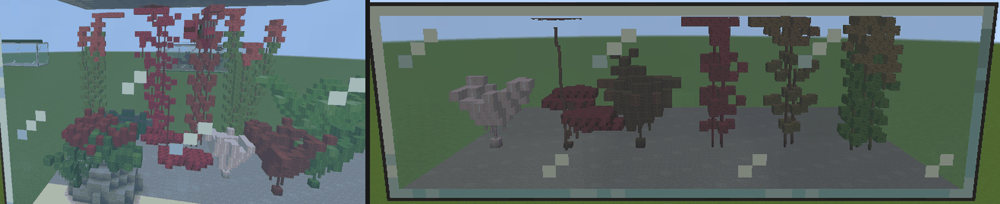
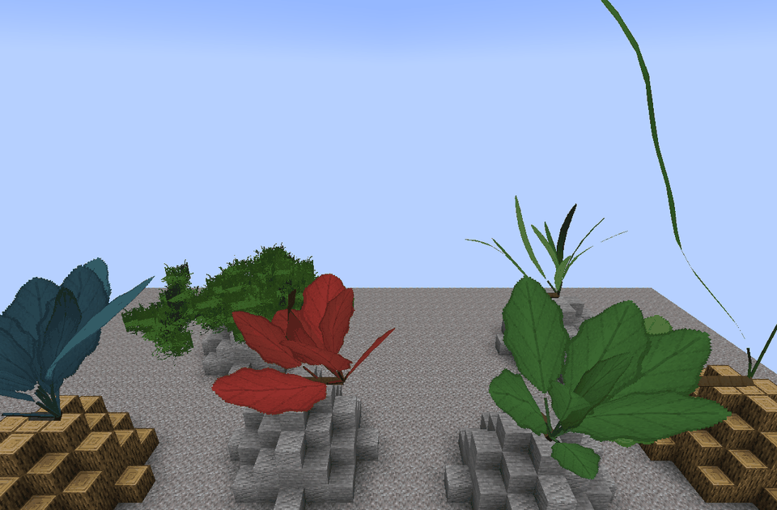
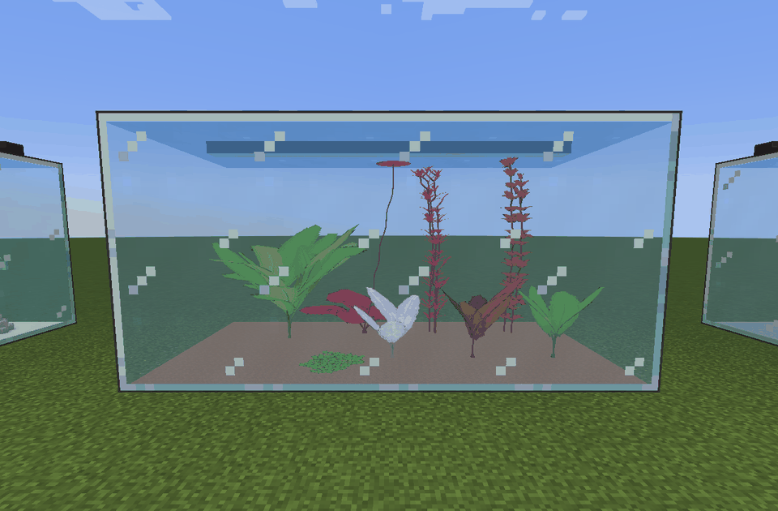

---
navigation:
  title: Care, trimming and cuttings
  icon: minecraft:shears
  parent: plants.md
  position: 10
---

# Care, trimming and cuttings

## Growing

* Plants grow with **light** at the surface (a lit [tank light](../equipment/light.md) or daylight), **nutrients**
  (the waste of the animals, see [water quality](../aquarium/water_quality.md)) and a water temperature of 20-30 °C.
  Epiphytes, moss and crypts are content with little light; stem plants and Monte Carlo need strong light.
* They grow **also while nobody is in the interior**: the aquarium keeps track of every plant and writes the blocks of
  a new stage when it is due. You see the miniature grow.
* **Red plants get redder with more light**: Rotala at the tips, Ludwigia, Alternanthera, the brown crypt, the Brownie
  Red and the tiger lotus. The Flamingo crypt stays whitish pink and gets brighter.

* Stem plants grow up to the surface and run along it. Together with dense [floating plants](floating_plants.md) they
  shade the aquarium: the menu warns, the plants below grow slower. Trim them.
* At most 48 plants grow in one aquarium; side shoots and runners keep some distance to each other.

## Trimming, dividing, taking out

* **Shears** on a plant block in the interior cut the plant back by a stage or two; you get **cuttings** (Ableger). Plant
  a cutting and it grows into a new plant: this is the main way to get more plants.
* **Shears on the aquarium from outside** trim the plant you look at in the miniature (decoration in front of it hides
  it).
* **Breaking the root block** (the lowest block where you planted it) takes the whole plant out; the item keeps its
  size and you can plant it elsewhere.
* **Breaking a rhizome piece** of an epiphyte divides it: half of it comes out as a new plant.
* Stem plants form **side shoots**, Vallisneria, Monte Carlo and the crypts send out **runners** by themselves.
* When an aquarium block is broken, the plants rooted in it drop as items.

## What they do

* Plants **take up waste** while they have light: the more plant mass, the longer the water stays clean.
* Dense plants are **hiding spots**: after spawning the male chases the female less often (up to 60 % less).
* A well planted aquarium (plants of at least 3 % of the water volume) makes the male ready for a nest a little
  faster (1.1x).

## The look

Every plant has **real leaves** instead of leaf blocks, inside the interior and in the miniature outside the aquarium,
and they sway in the water. The blocks are still there (shears and breaking work as before), they are only drawn
differently. From further away than 24 blocks the miniature shows the plants as pixels again
(`render.miniaturePlantMeshDistance`). In the Mod settings (*Rendering*, `render.plantMeshes`) every player can switch
back to the blocks; `features.visuals.plantMeshes` switches it off for the whole pack.

All values can be changed in the server config (`interiorPlants.*`).
