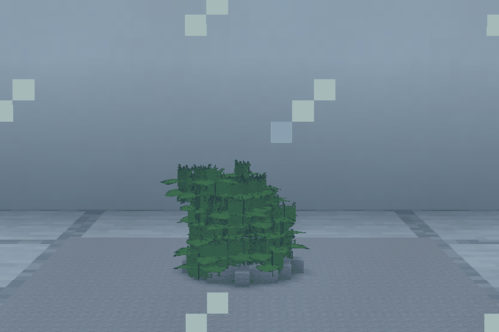

---
navigation:
  title: Christmas Moss
  icon: bettacraft:christmas_moss
  parent: plants/epiphytes.md
  position: 71
item_ids:
  - bettacraft:christmas_moss
---

# Christmas Moss

Christmas moss (*Vesicularia montagnei*) from Asia: flat fronds in tiers like little fir trees.

## Profile

| | |
|---|---|
| Growth form | moss |
| Grows on | any solid block |
| Light | low |
| Full size | after about 8 days |
| Spreads | no |
| Cuttings per trim | 2 |

## Care

* Holds on to **any solid block**; little light.
* Like Java moss a place for the eggs of the egg scatterers and for shrimp.

## Obtaining

* **[Aquarium net](../equipment/tank_net.md)** in rivers: 0.24–0.29 % per swing (about 1 in 347–417 swings) (config `features.plantNetCatches`).
* **Fishing** in rivers: 0.1 % per catch (about 1 in 1033 catches), instead of the fish.
* **Cuttings**: shears on a grown plant give 2 cuttings per trim.

The biomes of biome mods count too ([biome tags](../settings.md)).
