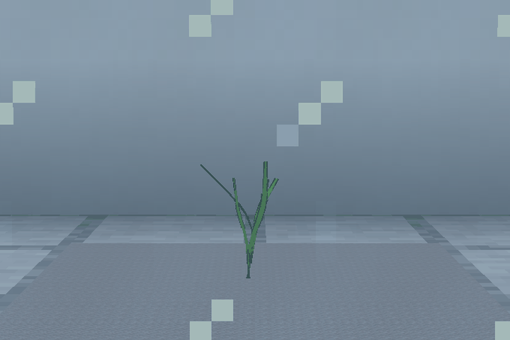

---
navigation:
  title: Cryptocoryne Parva
  icon: bettacraft:cryptocoryne_parva
  parent: plants/rosettes.md
  position: 31
item_ids:
  - bettacraft:cryptocoryne_parva
---

# Cryptocoryne Parva

*Cryptocoryne parva* from Sri Lanka: the smallest Cryptocoryne, narrow little leaves.

## Profile

| | |
|---|---|
| Growth form | rosette |
| Grows on | substrate (sand, gravel, dirt, the interior floor) |
| Light | low |
| Full size | after about 16 days |
| Spreads | runners |
| Cuttings per trim | 1 |

## Care

* Very slow, little light.
* Grows into a lawn by runners over time.

## Obtaining

* **[Aquarium net](../equipment/tank_net.md)** in rivers: 0.16–0.19 % per swing (about 1 in 521–625 swings) (config `features.plantNetCatches`).
* **Fishing** in rivers: 0.1 % per catch (about 1 in 1033 catches), instead of the fish.
* **Shears** on a wild plant in jungle water: 100 % per cut (config `features.wildPlants`).
* **Cuttings**: shears on a grown plant give 1 cutting per trim; it also spreads by itself (runners).

The biomes of biome mods count too ([biome tags](../settings.md)).
