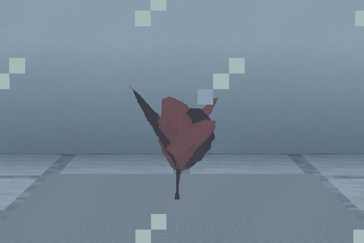

---
navigation:
  title: Cryptocoryne Wendtii (Brown)
  icon: bettacraft:cryptocoryne_wendtii_brown
  parent: plants/rosettes.md
  position: 20
item_ids:
  - bettacraft:cryptocoryne_wendtii_brown
---

# Cryptocoryne Wendtii (Brown)

*Cryptocoryne wendtii* "Brown" from Sri Lanka: wavy brown-red leaves.

## Profile

| | |
|---|---|
| Growth form | rosette |
| Grows on | substrate (sand, gravel, dirt, the interior floor) |
| Light | medium |
| Full size | after about 9 days |
| Spreads | runners |
| Cuttings per trim | 1 |
| Colour | redder in strong light |

## Care

* In the substrate; medium light, redder in strong light.
* Sends out runners once grown.

## Obtaining

* **[Aquarium net](../equipment/tank_net.md)** in swamps: 0.58–0.69 % per swing (about 1 in 144–173 swings) (config `features.plantNetCatches`).
* **Fishing** in swamps: 0.79 % per catch (about 1 in 127 catches), instead of the fish.
* **Fishing** in mangrove swamps: 1.2 % per catch (about 1 in 85 catches), instead of the fish.
* **Glass bottle** filled with water in swamps: 1.1 % per bottle, along with the water.
* **Cuttings**: shears on a grown plant give 1 cutting per trim; it also spreads by itself (runners).

The biomes of biome mods count too ([biome tags](../settings.md)).
