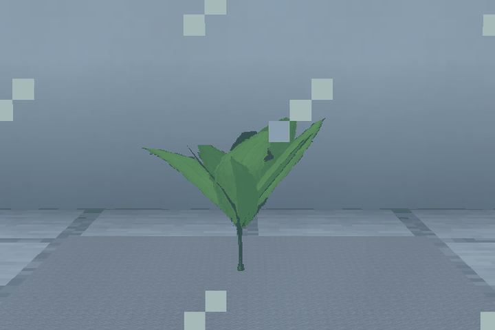

---
navigation:
  title: Cryptocoryne Wendtii (Green)
  icon: bettacraft:cryptocoryne_wendtii_green
  parent: plants/rosettes.md
  position: 10
item_ids:
  - bettacraft:cryptocoryne_wendtii_green
---

# Cryptocoryne Wendtii (Green)

*Cryptocoryne wendtii* "Green" from Sri Lanka: a rosette of green leaves on stalks.

## Profile

| | |
|---|---|
| Growth form | rosette |
| Grows on | substrate (sand, gravel, dirt, the interior floor) |
| Light | low |
| Full size | after about 9 days |
| Spreads | runners |
| Cuttings per trim | 1 |

## Care

* In the substrate; little light.
* Sends out runners once grown.

## Obtaining

* **Fishing** in swamps and mangrove swamps: 1.6 % per catch, instead of the fish.
* **Glass bottle** filled with water in swamps: 1.5 % per bottle, along with the water.
* **Cuttings**: shears on a grown plant give 1 cutting per trim; it also spreads by itself (runners).
