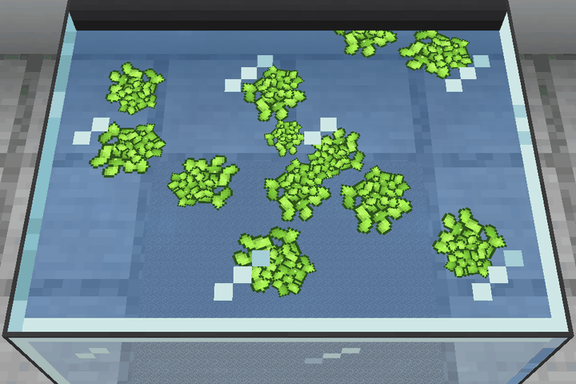

---
navigation:
  title: Duckweed
  icon: bettacraft:duckweed
  parent: plants/floating_plants.md
  position: 10
item_ids:
  - bettacraft:duckweed
---

# Duckweed

Duckweed (*Lemna minor*), found on still water almost everywhere: tiny leaves in small patches, the fastest grower.

## Profile

| | |
|---|---|
| Growth form | floating plant |
| Leaf size | up to 4.1 cm |
| Growth | very fast |
| Waste uptake | ×0.9 |
| Nest site | so-so |
| Roots | short |

## Care

* Grows fastest and takes up waste; it can cover the whole surface and shade the tank.
* Comes up now and then in a bottle of swamp water.

## Obtaining

* **Fishing** in swamps: 2.7 % per catch (about 1 in 37 catches), instead of the fish.
* **Fishing** in mangrove swamps: 2.1 % per catch (about 1 in 48 catches), instead of the fish.
* **Glass bottle** filled with water in swamps: 15 % per bottle, along with the water.
* **Offshoots**: grows on a lit aquarium surface and forms offshoots; take some out with the aquarium net.

The biomes of biome mods count too ([biome tags](../settings.md)).
