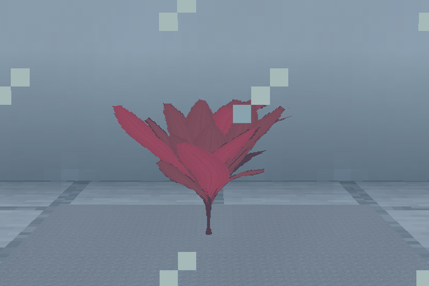

---
navigation:
  title: Echinodorus 'Red Diamond'
  icon: bettacraft:echinodorus_red_diamond
  parent: plants/rosettes.md
  position: 41
item_ids:
  - bettacraft:echinodorus_red_diamond
---

# Echinodorus 'Red Diamond'

*Echinodorus* "Red Diamond": a compact sword plant with wine-red leaves.

## Profile

| | |
|---|---|
| Growth form | rosette |
| Grows on | substrate (sand, gravel, dirt, the interior floor) |
| Light | medium |
| Full size | after about 8 days |
| Spreads | no |
| Cuttings per trim | 1 |
| Colour | redder in strong light |

## Care

* Medium light; the stronger the light, the redder the leaves.
* Smaller than the Amazon sword: fits in smaller tanks.

## Obtaining

* **[Aquarium net](../equipment/tank_net.md)** in jungle water: 0.23–0.27 % per swing (about 1 in 369–443 swings) (config `features.plantNetCatches`).
* **Fishing** in jungle water: 0.14 % per catch (about 1 in 730 catches), instead of the fish.
* **Cuttings**: shears on a grown plant give 1 cutting per trim.

The biomes of biome mods count too ([biome tags](../settings.md)).
