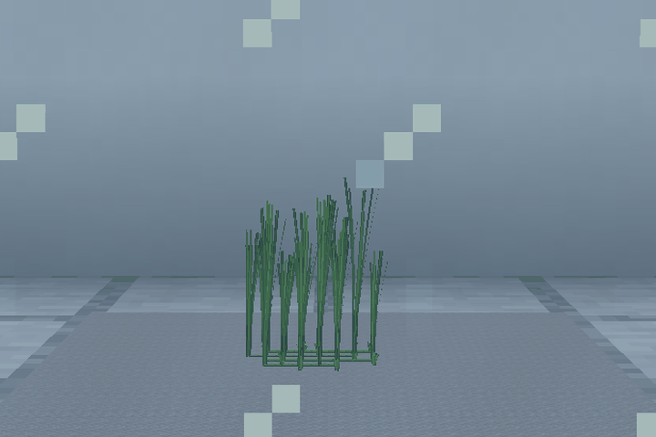

---
navigation:
  title: Eleocharis (Hairgrass)
  icon: bettacraft:eleocharis_acicularis
  parent: plants/runners.md
  position: 40
item_ids:
  - bettacraft:eleocharis_acicularis
---

# Eleocharis (Hairgrass)

Hairgrass (*Eleocharis acicularis*): a lawn of thin, upright needles that spreads by runners.

## Profile

| | |
|---|---|
| Growth form | carpet |
| Grows on | substrate (sand, gravel, dirt, the interior floor) |
| Light | medium |
| Full size | after about 3.5 days |
| Spreads | runners |
| Cuttings per trim | 2 |

## Care

* Medium light; the needles sway in the current.
* A lawn for the foreground; shrimp like to graze in it.

## Obtaining

* **[Aquarium net](../equipment/tank_net.md)** in swamps: 0.23–0.28 % per swing (about 1 in 361–433 swings) (config `features.plantNetCatches`).
* **Fishing** in swamps: 0.09 % per catch (about 1 in 1057 catches), instead of the fish.
* **Cuttings**: shears on a grown plant give 2 cuttings per trim; it also spreads by itself (runners).

The biomes of biome mods count too ([biome tags](../settings.md)).
