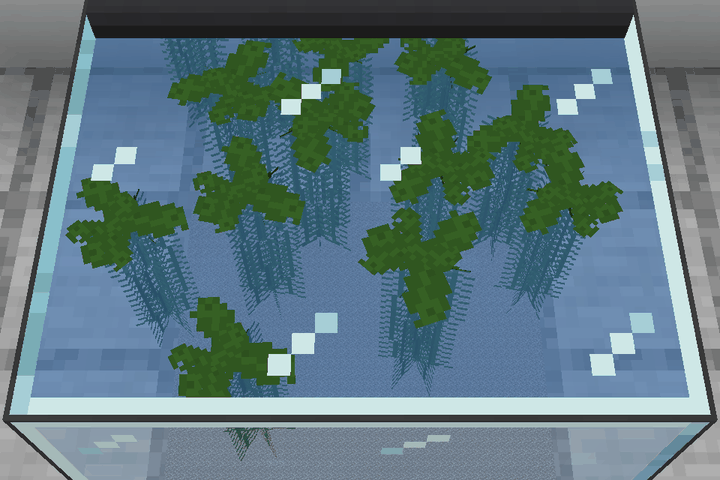

---
navigation:
  title: Hornwort
  icon: bettacraft:hornwort
  parent: plants/floating_plants.md
  position: 60
item_ids:
  - bettacraft:hornwort
---

# Hornwort

Hornwort (*Ceratophyllum demersum*): rootless shoots with whorls of stiff leaves that float free just under the surface.

## Profile

| | |
|---|---|
| Growth form | floating plant |
| Leaf size | up to 4.8 cm |
| Growth | very fast |
| Waste uptake | ×1.6 |
| Nest site | so-so |
| Roots | none: its shoots hang deep into the water |

## Care

* Grows fast and takes up the most waste of all floating plants.
* Its shoots hang deep into the water column.

## Obtaining

* **Fishing** in swamps: 0.67 % per catch (about 1 in 150 catches), instead of the fish.
* **Fishing** in mangrove swamps: 0.4 % per catch (about 1 in 250 catches), instead of the fish.
* **Breaking wild floating plants** in swamps: 100 % per block (config `features.wildPlants`).
* **Breaking wild floating plants** in rivers: 100 % per block (config `features.wildPlants`).
* **Breaking wild floating plants** in cold lakes and frozen rivers: 100 % per block (config `features.wildPlants`).
* **Offshoots**: grows on a lit aquarium surface and forms offshoots; take some out with the aquarium net.

The biomes of biome mods count too ([biome tags](../settings.md)).
