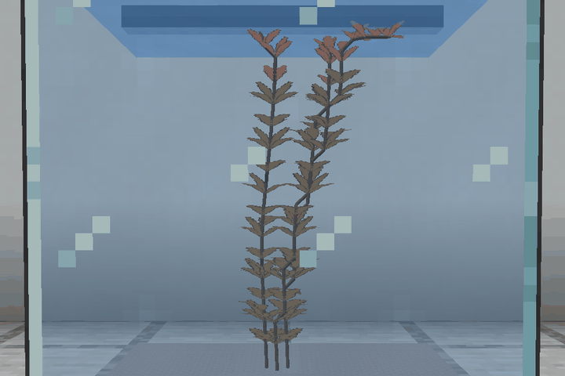

---
navigation:
  title: Hygrophila Pinnatifida
  icon: bettacraft:hygrophila_pinnatifida
  parent: plants/stem_plants.md
  position: 70
item_ids:
  - bettacraft:hygrophila_pinnatifida
---

# Hygrophila Pinnatifida

*Hygrophila pinnatifida* from India: deeply lobed, olive brown leaves. Its roots also hold on to stone and wood.

## Profile

| | |
|---|---|
| Growth form | stem plant |
| Grows on | substrate (sand, gravel, dirt, the interior floor), also stone and wood |
| Light | medium |
| Full size | after about 5 days |
| Spreads | side shoots |
| Cuttings per trim | 3 |
| Colour | redder in strong light |

## Care

* Plant it in the substrate or on stone and wood (rocks, roots, decoration).
* Medium light; reddish in strong light.

## Obtaining

* **[Aquarium net](../equipment/tank_net.md)** in rivers: 0.38–0.46 % per swing (about 1 in 217–260 swings) (config `features.plantNetCatches`).
* **Fishing** in rivers: 0.15 % per catch (about 1 in 685 catches), instead of the fish.
* **Cuttings**: shears on a grown plant give 3 cuttings per trim; it also spreads by itself (side shoots).

The biomes of biome mods count too ([biome tags](../settings.md)).
